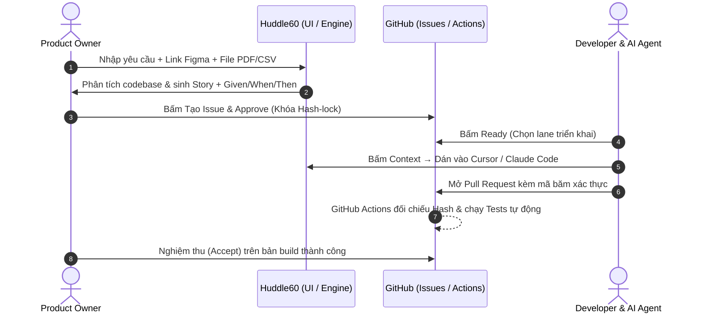

<h1 align="center">huddle60</h1>

<p align="center">
  <b>Hội ý 60 giây giữa PO, DEV và AI Coding Agents.</b><br>
  Đầu vào: Một yêu cầu nghiệp vụ. Đầu ra: Một Lát cắt dọc (Vertical Slice) được khóa bằng mã băm.<br>
  PR kiểm thử tự động, không còn nỗi lo trôi dạt yêu cầu.
</p>

<p align="center">
  = 20" src="https://img.shields.io/badge/node-%3E%3D20-339933?logo=node.js">
  
  
  
</p>

```bash
npx huddle60 ui
```

---

## 💡 Huddle60 Giải Quyết Bài Toán Gì?

Trong các nhóm phát triển hiện nay, AI (Cursor, Claude Code, Copilot) gõ code rất nhanh nhưng sản phẩm vẫn ra mắt chậm vì **3 nút thắt lớn**:
1. **Lệch pha PO – DEV:** PO mô tả mơ hồ hoặc viết ticket kiểu giao diện rời rạc; DEV đưa vào AI sinh ra code không đúng mong đợi hoặc thiếu bài kiểm thử.
2. **Cái bẫy chia task theo tầng ngang (Horizontal Tasks):** Chia việc thành task DB riêng, task API riêng, task UI riêng làm phân mảnh ngữ cảnh của AI, không thể nghiệm thu độc lập từng tính năng.
3. **Trôi dạt yêu cầu (Requirement Drift):** Yêu cầu bị sửa ngầm trên ticket sau khi DEV đã bắt đầu code, khiến AI làm theo bản cũ và gây xung đột khi merge.

**Huddle60** thay thế các buổi họp phân rã công việc kéo dài hàng giờ bằng một **cuộc hội ý 60 giây (60-second huddle)**: biến yêu cầu thành một **Lát cắt dọc (Vertical Slice)** duy nhất, khóa cứng bằng mã băm SHA-256 và kiểm định tự động trên GitHub Actions.

| Vai trò | Trước đây | Với Huddle60 |
| :--- | :--- | :--- |
| **PO** | Viết ticket dài dòng trên Jira, không rõ DEV & AI đang làm theo bản spec nào | Nhập yêu cầu (kèm link Figma, file PDF/CSV) $\rightarrow$ AI sinh tiêu chí nghiệm thu rõ ràng. PO bấm **Approve** chốt baseline. |
| **DEV** | Nhận ticket mơ hồ, copy-paste thủ công vào Cursor dễ thiếu ngữ cảnh | Bấm **Context** để copy chỉ thị kỹ thuật chuẩn kèm mã băm dán thẳng vào Cursor/Claude Code. |
| **Team** | Merge code xong vẫn nơm nớp lo tính năng không chạy được từ đầu đến cuối | Mỗi PR là một Lát cắt dọc full-stack hoàn chỉnh; có test tự động chứng minh pass 100% AC mới được duyệt. |

---

## 🎯 Triết Lý Cốt Lõi: Lát Cắt Dọc (Vertical Testable Slice)

Truyền thống thường chia công việc theo tầng công nghệ: *Task 1: Tạo bảng DB $\rightarrow$ Task 2: Viết API $\rightarrow$ Task 3: Vẽ UI*. Cách này sinh ra do con người bị giới hạn bởi chuyên môn hóa (Frontend / Backend / DBA).

Nhưng trong kỷ nguyên của **AI Coding Agents**:
- **AI là Full-stack mặc định:** Cursor hoặc Claude Code hoàn toàn có thể sửa DB migration, viết API endpoint, dựng UI và viết bài kiểm thử trong **cùng một Pull Request**.
- **Không gãy ngữ cảnh:** Khi nhận trọn vẹn một Lát cắt dọc, AI hiểu toàn diện luồng dữ liệu từ giao diện người dùng đến database, không cần mock dữ liệu chắp vá.
- **Quy tắc 1 Story = 1 Lát cắt kiểm thử được:** Mỗi Issue trong Huddle60 là một tính năng hoàn chỉnh, đi kèm các tiêu chí nghiệm thu **Given / When / Then** và bài test tự động bắt buộc.

```
┌─────────────────────────────────────────────────────────────┐
│             LÁT CẮT DỌC (VERTICAL TESTABLE SLICE)           │
├─────────────────────────────────────────────────────────────┤
│  🖥️ UI Layer        Giao diện & Trải nghiệm người dùng      │
│      ▲                                                      │
│      │                                                      │
│  ⚙️ API Layer       Xử lý nghiệp vụ & Bảo mật endpoints     │
│      ▲                                                      │
│      │                                                      │
│  🗄️ Data Layer      Database Schema & Migration             │
├─────────────────────────────────────────────────────────────┤
│  🧪 Automated Test   Chứng minh tất cả Given/When/Then pass │
└─────────────────────────────────────────────────────────────┘
```

---

## ⚡ Các Tính Năng Chính

- **Lập kế hoạch đa phương thức (Multimodal Planning):** Nhận cả văn bản, liên kết ngoài (Figma, Miro, Swagger API) và tệp đính kèm (Ảnh mockup PNG/JPG, tài liệu PDF, bảng tính CSV). Gemini Flash tự động trích xuất thông tin để sinh tiêu chí nghiệm thu chuẩn xác.
- **Thấu hiểu Codebase (Codebase-Aware):** Tự động đọc cấu trúc thư mục repo, `package.json` và `README.md` để sinh kế hoạch phù hợp với công nghệ hiện tại của dự án.
- **Khóa yêu cầu bằng mật mã (Hash-Lock RFC 8785):** Mỗi Story được chốt thành một baseline có mã băm SHA-256 bất biến. Nếu có ai sửa yêu cầu sau khi PO đã duyệt, GitHub Actions sẽ tự động phát hiện và chặn PR.
- **Bàn giao ngữ cảnh cho IDE (Context Handover):** DEV chỉ cần 1-click để copy khối Markdown tối ưu dành riêng cho Cursor / Claude Code / Copilot, hướng dẫn AI viết code full-stack kèm test.
- **Zero-Database & Git-Native:** Không cần dựng máy chủ hay cơ sở dữ liệu riêng. Toàn bộ chính sách (RBAC), lịch sử quyết định và bằng chứng kiểm toán được lưu trữ bất biến trên nhánh Git `huddle60-evidence`.
- **Giao diện Web siêu tốc (Zero-Build Vanilla UI):** Khởi chạy trong 10ms, hỗ trợ quản lý đa repository, tự động kết nối tài khoản qua GitHub CLI (`gh`).

---

## 🚀 Bắt Đầu Nhanh

Yêu cầu môi trường: **Node.js >= 20**.

### 1. Khởi tạo Huddle60 trên Repository của bạn

Đứng tại thư mục gốc của dự án trên máy tính:

```bash
npx huddle60 init
```

Lệnh này sẽ tạo cấu hình phân quyền `.github/huddle60/policy.yml` và workflow `.github/workflows/huddle60.yml`.

### 2. Khởi chạy Giao diện Điều phối

```bash
npx huddle60 ui
```

Trình duyệt sẽ tự động mở tại `http://localhost:4317`.  
*(Nếu bạn đã cài GitHub CLI `gh`, chỉ cần bấm **"Tự động kết nối từ GitHub CLI"** là xong, không cần tạo PAT thủ công).*

---

## 🔄 Quy Trình 60 Giây Trong Thực Tế



### Các lệnh tương tác qua GitHub Comment (hoặc bấm nút trên Web UI)

| Lệnh | Vai trò | Tác dụng |
| :--- | :--- | :--- |
| `/huddle60 baseline` | PO, DEV | Chụp snapshot yêu cầu hiện tại của Issue, tính mã băm SHA-256 |
| `/huddle60 approve baseline=<id> hash=<sha>` | **PO** | Duyệt nghiệp vụ của Story (khóa yêu cầu) |
| `/huddle60 ready baseline=<id> hash=<sha> lane=<fast\|standard\|strict>` | **DEV** | Xác nhận sẵn sàng triển khai, chọn luồng kiểm định |
| `/huddle60 accept baseline=<id> run=<run_id> commit=<sha>` | **PO** | Nghiệm thu tính năng trên bản build `main` và đóng Issue |

---

## 📚 Tài Liệu Tham Khảo

- [Series 10 Bài Viết: Chuyển Đổi Sang Kỷ Nguyên AI-DLC Cùng Huddle60](docs/blog-series/README.md)
- [Cẩm nang Quy trình Vận hành Huddle60 (Workflow Guide)](docs/huddle60-workflow-guide.md)
- [Tài liệu Kiến trúc Kỹ thuật (Technical Implementation)](docs/technical-implementation.md)
- [Xu hướng Monorepo & AI-DLC](docs/monorepo-trend-and-ai-dlc.md)

---

## 🤝 Về Dự Án & Đóng Góp

**Huddle60** ban đầu là công cụ nội bộ do tôi viết để giải quyết các nút thắt vận hành thực tế cho team nhỏ của mình. Nhận thấy công cụ giúp ích rất nhiều cho việc cộng tác giữa PO, DEV và AI, tôi quyết định mở toàn bộ mã nguồn trên GitHub theo giấy phép **MIT**.

Nếu bạn thấy phù hợp với nhu cầu của team mình, bạn cứ thoải mái lấy về sử dụng hoặc tùy biến thêm. Nếu gặp lỗi, có trường hợp biên cần tối ưu, hoặc có ý tưởng mới (như viết adapter cho các mô hình AI khác hay bộ phân tích file riêng), rất hoan nghênh bạn mở Issue hoặc gửi Pull Request để cùng nhau hoàn thiện công cụ này!

👉 **Mã nguồn dự án:** [https://github.com/tadev999/huddle60](https://github.com/tadev999/huddle60)
