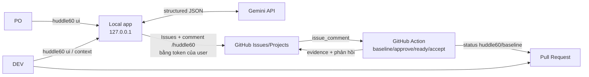

<h1 align="center">huddle60</h1>

<p align="center">
  <b>The 60-second huddle between PO, DEV and AI.</b><br>
  One sentence in. A hash-locked plan out. PRs that can’t drift.
</p>

<p align="center">
  
  
  
  
</p>

```bash
npx huddle60 ui
```

**PO gõ một câu → AI soạn Epic/Story/Task → PO bấm _approve_ → DEV bấm _ready_ → agent code đúng yêu cầu đã khóa
bằng hash → ai sửa yêu cầu sau khi chốt, PR tự đỏ.**

Bỏ buổi grooming 60 phút. Thay bằng một **huddle 60 giây**.

<p align="center">
  
</p>

### 60 giây trông như thế nào

| Giây | Ai | Việc |
|---|---|---|
| 0–10 | **PO** | Gõ _“Lập trình login sử dụng Google OAuth”_ |
| 10–30 | **AI** | Soạn Epic → Story → Task, AC dạng Given/When/Then, câu hỏi chặn và giả định |
| 30–45 | **PO** | Trả lời một câu hỏi, bấm **create issues**, rồi **approve** Story |
| 45–60 | **DEV** | Chọn lane, bấm **ready**, bấm **context** → dán vào Copilot/Claude/Gemini trong IDE |

Từ đó trở đi, mọi PR đều phải khớp đúng phiên bản yêu cầu đã duyệt. Không còn _“AI code theo bản cũ”_.

### Vì sao developer sẽ star

- **`package-lock.json` cho yêu cầu.** Mỗi Story được chốt thành baseline có SHA-256 (RFC 8785). Issue bị sửa →
  hash lệch → check `huddle60/baseline` chuyển đỏ. Giống hệt lockfile, nhưng cho nghiệp vụ.
- **Zero infra.** Không server, không database, không SaaS. Một lệnh `npx` trên máy bạn + GitHub Actions.
- **Agent-native.** `huddle60 context --issue 15` xuất đúng baseline đã duyệt cho bất kỳ coding agent nào, kèm
  khối dán vào PR.
- **AI đề xuất, người quyết định.** Gemini không có quyền GitHub. App không có quyền hơn bạn. Mọi quyết định
  được Actions kiểm tra theo user ID và ghi vào branch bằng chứng.
- **GitHub là nguồn sự thật.** Tận dụng Issues, Projects, PR quen thuộc của repository.

### Định vị: huddle60 & AI-DLC

**huddle60** là bộ công cụ và governance engine mã nguồn mở thực thi quy trình **AI-DLC (AI Development Life Cycle)** trực tiếp trên GitHub:
- **AI-DLC** là phương pháp luận và chuẩn quy trình: AI tham gia phát triển phần mềm trong phạm vi được giao, con người định hướng và phê duyệt, mọi bước đều có bằng chứng số (evidence hash-locked).
- **huddle60** là công cụ hiện thực hóa quy trình này một cách tự nhiên nhất vào GitHub:
  - Lệnh tương tác: `/huddle60` (hỗ trợ tương thích ngược với `/ai-dlc`)
  - Nhãn phân loại: `huddle60:*` (như `huddle60:request`, `huddle60:plan-draft`...)
  - PR verification gate: status check `huddle60/baseline`
  - Bằng chứng kiểm toán: nhánh `huddle60-evidence`
  - Cấu hình chính sách: `.github/huddle60/policy.yml`

### Triết lý AI-Native: Lát cắt dọc kiểm thử được (Vertical Testable Slices)

Trong thời kỳ Agile truyền thống, các nhóm phát triển thường chia nhỏ công việc theo **tầng công nghệ nằm ngang (Horizontal Layers)**:
- *Task 1:* Tạo nút giao diện (Frontend dev làm)
- *Task 2:* Viết API endpoint (Backend dev làm)
- *Task 3:* Viết migration cơ sở dữ liệu (DBA làm)

Cách chia này sinh ra vì **con người bị giới hạn bởi chuyên môn hóa**. Nhưng trong kỷ nguyên của **AI Coding Agents (Cursor, Claude Code, Copilot)**:
1. **AI là Fullstack-by-default:** Một Coding Agent có thể cùng lúc sửa DB, viết API, hoàn thiện UI và viết bài kiểm thử trong **duy nhất 1 Pull Request**.
2. **Không gãy ngữ cảnh (Zero Context Fragmentation):** Việc tách riêng task UI và API khiến Agent làm UI phải tạo dữ liệu giả lập (mock), còn Agent làm API không biết UI render thế nào. Hậu quả là không có PR nào có thể chạy thử nghiệm độc lập được.
3. **Đầu vào là Yêu cầu → Đầu ra là Tính năng kiểm thử được (Testable Feature Slice):**
   - Mỗi Issue trong `huddle60` là một **lát cắt dọc hoàn chỉnh** từ giao diện đến dữ liệu.
   - Đi kèm các tiêu chí nghiệm thu **Given / When / Then** định lượng rõ ràng.
   - AI Agent khi nhận Issue bắt buộc phải code kèm bài test tự động (Automated Test) chứng minh toàn bộ tiêu chí đều pass trước khi tạo PR.

Đặc tả đầy đủ: [tài liệu kỹ thuật](docs/technical-implementation.md).

> Thấy hữu ích? Hãy **star** repo và thử trên một repo thử nghiệm. Dự án đang alpha và cần người chạy thật nhất.

## Vì sao PO và DEV sẽ thích

| | Hôm nay | Với huddle60 |
|---|---|---|
| **PO** | Ngồi viết từng ticket, AC, chia việc | Gõ _“Lập trình login sử dụng Google OAuth”_ → AI soạn các lát cắt tính năng kèm AC. PO chỉ trả lời câu hỏi và xác nhận |
| **PO** | Không chắc DEV/AI đang làm theo phiên bản yêu cầu nào | Mỗi PR gắn baseline có hash; sửa yêu cầu sau khi chốt thì PR **tự bị chặn** |
| **DEV** | Ticket mơ hồ, hỏi đi hỏi lại | Nhận Story có AC rõ ràng; câu hỏi chặn đã được PO trả lời **trước** khi Issue được tạo |
| **DEV** | Copy yêu cầu vào agent bằng tay, dễ sót | `huddle60 context --issue 15` đưa đúng baseline vào agent trong IDE của bạn kèm yêu cầu test |
| **Cả team** | Merge xong vẫn không rõ “xong chưa” | Done chỉ khi PO nghiệm thu đúng build trên `main`; mọi quyết định truy vết được |

### PO thấy gì sau 30 giây?

Chạy `huddle60 ui`, gõ yêu cầu vào tab **Lập kế hoạch**, bấm **Tạo kế hoạch** (rút gọn):

> ## Kế hoạch đề xuất (revision 1)
> Đăng nhập bằng Google OAuth cho ứng dụng web.
>
> - **Epic** `epic-auth`: Xác thực người dùng bằng Google OAuth
>   - **Story** `google-login-flow`: Đăng nhập thành công lần đầu và tạo hồ sơ người dùng
>     - AC-01: Given người dùng ở trang login When bấm 'Sign in with Google' Then chuyển hướng sang Google OAuth
>     - AC-02: Given cấp quyền hợp lệ When callback hoàn tất Then tạo phiên đăng nhập và chuyển về dashboard
>     - AC-03: Given người dùng lần đầu đăng nhập Then tạo bản ghi user mới từ email và tên Google
>     - **Verification**: Kèm bài test E2E/Integration kiểm tra toàn bộ luồng từ UI đến DB
>   - **Story** `google-login-error`: Xử lý khi hủy cấp quyền hoặc token hết hạn
>     - AC-04: Given người dùng hủy cấp quyền When quay lại Then hiển thị thông báo lỗi phù hợp và không tạo phiên
>   - **Story** `story-logout`: Đăng xuất và hủy phiên
>
> **Câu hỏi chặn:** Nếu email Google trùng với tài khoản mật khẩu cũ thì tự động liên kết hay yêu cầu xác nhận mật khẩu?

PO bấm **create 5 issues** → Issues được tạo, liên kết cha–con và nằm sẵn trên Project board. Chưa đồng ý → gõ một dòng
vào ô **refine**, AI soạn lại. Có câu hỏi chặn thì nút tạo bị khóa đến khi PO trả lời.

**Trạng thái: alpha, cần cộng đồng kiểm thử.** Logic được kiểm thử tự động bằng fake GitHub/Gemini (105 test),
nhưng **chưa được chạy đầu-cuối trên GitHub và Gemini thật**. Xem [Giới hạn đã biết](#giới-hạn-đã-biết).

## Bắt đầu nhanh

```bash
gh auth login                          # app dùng token GitHub của chính bạn
export GEMINI_API_KEY=...              # chỉ PO cần (để soạn kế hoạch); macOS có thể lưu vào Keychain:
                                       # security add-generic-password -s huddle60-gemini -a $USER -w
npx huddle60 ui --repo owner/name
```

App mở trình duyệt tại `http://127.0.0.1:4317/#token=…`:

- **work items**: mọi Epic/Story/Task đang mở, trạng thái _chờ PO duyệt → chờ DEV ready → đang làm_, cảnh báo khi
  Issue bị sửa sau quyết định. Nút **approve / ready (lane) / accept / context** hiện theo role của bạn trong policy.
- **new plan**: mô tả nhu cầu → cây công việc, câu hỏi chặn, giả định → refine → tạo Issues.
- **activity**: lệnh đã gửi và phản hồi của GitHub Actions.

Mỗi nút chỉ đăng một comment `/huddle60 …` **bằng tài khoản của bạn**; GitHub Actions kiểm tra role, hash, phụ thuộc rồi
ghi bằng chứng. App không có quyền gì hơn bạn và không tự quyết thay ai.

Bảo mật app: chỉ nghe `127.0.0.1`, token phiên ngẫu nhiên mỗi lần chạy, kiểm tra `Host`/`Origin` (chống DNS rebinding,
CSRF), CSP chặt, không dựng HTML từ dữ liệu.

## Cách hoạt động



| Thành phần | Chạy ở đâu | Làm gì |
|---|---|---|
| **Local app** (`src/app`, `ui/`) | Máy PO/DEV (`huddle60 ui`) | Soạn kế hoạch với Gemini, tạo cây Issues, nút approve/ready/accept, context cho IDE agent |
| **Workflow gates** (`src/workflow`) | GitHub Actions (`action.yml`) | Baseline có hash, quyết định PO/DEV, check `huddle60/baseline` cho PR, nghiệm thu build |
| **CLI** (`src/entry/cli.ts`) | Máy DEV | `context` cho IDE agent, `init`, kiểm tra policy, thử planner |
| **Lõi** (`src/core`) | Dùng chung | Hash canonical (RFC 8785), parser, schema kế hoạch, kiểm tra quyết định — không phụ thuộc mạng |

Nguyên tắc: **AI đề xuất, con người quyết định.** Gemini không có quyền gọi GitHub; mọi quyết định được GitHub Actions
kiểm tra theo GitHub user ID trong `.github/huddle60/policy.yml`. Thiết kế đầy đủ:
[tài liệu kỹ thuật](docs/technical-implementation.md).

## Luồng sử dụng

1. **PO** mở `huddle60 ui` → **new plan**, gõ: _“Xây dựng tính năng đăng nhập Google OAuth”_ → trả lời câu hỏi chặn → **create issues**.
2. PO và DEV chỉnh nội dung Story trên GitHub nếu cần. Khi Story đã rõ: PO bấm **approve** (chốt đúng nội dung hiện tại).
3. DEV chọn lane và bấm **ready**. Task kế thừa approve của Story cha.
4. DEV bấm **context** (hoặc chạy CLI) để đưa baseline vào IDE agent, rồi mở PR kèm khối Huddle60 trong context:
   ```bash
   npx huddle60 context --issue 15
   ```
5. Sau khi merge và build trên `main` thành công, PO bấm **accept**, chọn build → Issue được đóng.

Không dùng app vẫn được: mọi nút tương ứng một lệnh comment bên dưới.

### Các lệnh qua GitHub Comment (xử lý bởi GitHub Action)

| Lệnh | Vai trò | Tác dụng |
|---|---|---|
| `/huddle60 baseline` | PO, DEV | Chụp snapshot yêu cầu của Issue, tính hash SHA-256 |
| `/huddle60 approve baseline=<id> hash=<h>` | PO | Duyệt nghiệp vụ của Story (Task kế thừa duyệt của Story cha) |
| `/huddle60 ready baseline=<id> hash=<h> lane=<fast\|standard\|strict>` | DEV | Xác nhận sẵn sàng code, sinh khối trace cho PR |
| `/huddle60 accept baseline=<id> run=<run_id> commit=<sha>` | PO | Nghiệm thu Story/Epic trên build thành công của branch `main`, đóng Issue |
| `/huddle60 revoke decision=<id> reason="..."` | Tác giả hoặc cùng role | Thu hồi quyết định đã ban hành |

*Lưu ý: Lệnh phải nằm ở **dòng đầu tiên** của comment (tiền tố `/huddle60`). Mọi quyết định đều được kiểm tra tính hợp lệ và ghi vào nhánh bằng chứng `huddle60-evidence`.*

## Phát triển

Yêu cầu: Node.js 22.

```bash
npm ci
npm run check      # typecheck + test + format
npm run build      # dist/action.js, dist/cli.js
```

Chạy app với dữ liệu thật từ mã nguồn: `npm run build && node dist/cli.js ui --repo owner/name`.

Thử planner với Gemini thật mà không cần GitHub (tốn quota của bạn):

```bash
GEMINI_API_KEY=... node dist/cli.js plan-preview "Xây dựng tính năng đăng nhập Google OAuth"
```

### Cấu trúc

```text
src/core/        Lõi thuần: canonical hash, policy, command, issue form, plan, baseline, decision, render
src/app/         Local app: LocalApp (plan, items, decisions), HTTP server bảo vệ bằng token/Host/Origin
ui/              Giao diện tĩnh (HTML/CSS/JS thuần, không build step)
src/planner/     Prompt, generatePlan, IssueTreeCreator
src/workflow/    WorkflowService (baseline, approve, ready, accept, revoke, PR gate), agent context
src/adapters/    GitHub (Octokit), evidence branch, Gemini, in-memory
src/entry/       action, cli
templates/       Tệp cho repository áp dụng: Issue forms, policy, workflow, PR template, AGENTS.md
tests/           Unit + kịch bản đầu-cuối với FakeGitHub/FakeModel
```

## Huddle60 dành cho Startup & Doanh nghiệp vừa và nhỏ

### 1. Tại sao Huddle60 sinh ra là dành cho Startup?
- **Nỗi đau lớn nhất của Startup hiện nay:**
  - Founder/PO thường có ý tưởng rất nhanh nhưng **không có thời gian viết tài liệu (PRD) chi tiết**, thường chỉ nhắn vài dòng trên Slack/Zalo.
  - DEV (hoặc AI coding tools như Cursor, Claude Code, Windsurf) khi nhận yêu cầu sơ sài sẽ **code sai hướng hoặc sinh ra code không có test**.
  - Startup **ghét sự cồng kềnh của Jira** (quá nặng nề, tốn phí, cấu hình phức tạp), nhưng lại thiếu một quy trình kiểm soát chất lượng chuẩn chỉnh (AI-DLC).
- **Lợi thế cạnh tranh của Huddle60:** Biến 1 câu chat của Founder thành **kế hoạch kiểm thử được (Vertical Slice)** trong 60 giây và quản lý tất cả trực tiếp trên **GitHub** mà không tốn thêm 1 xu tiền database hay máy chủ lưu trữ trung gian (Zero-Infra).

### 2. Mô hình sản phẩm tối ưu cho Startup (Sản phẩm trông như thế nào?)
Founder/PO thường không thích gõ lệnh terminal phức tạp. Họ cần một giao diện Web trực quan để xem và bấm duyệt. Vì vậy, Huddle60 được thiết kế tối ưu cho cả hai đối tượng:

```text
┌────────────────────────────────────────────────────────────────────────┐
│             HUDDLE60 DÀNH CHO STARTUP & DOANH NGHIỆP NHỎ               │
├────────────────────────────────────────────────────────────────────────┤
│                                                                        │
│   Founder / PO (Non-tech) ──┐                                         │
│                             ├─► [ Huddle60 Web Portal ] ◄── GitHub API │
│   Lead DEV / AI Engineer ───┘   (Dùng chung trong team)                │
│                                           │                            │
│                                           ▼                            │
│                              [ CÁC REPO CỦA STARTUP ]                  │
│                              ├── 1. backend-api                        │
│                              ├── 2. web-app (Next.js)                  │
│                              ├── 3. mobile-app (Flutter)               │
│                              └── 4. landing-page                       │
└────────────────────────────────────────────────────────────────────────┘
```

- **Quản lý Đa Repository (Project Switcher):** Một startup điển hình luôn có từ 2 đến 5 repo (`backend`, `web`, `mobile`). Bộ Project Switcher ở góc trên bên trái cho phép Founder/DEV chuyển đổi tức thì giữa các repo chỉ với 1 click.
- **Triển khai đội ngũ bằng Docker (1-Click Run):** Chạy Huddle60 cho cả team Founder & DEV bằng Docker Compose mà không cần cài đặt hạ tầng phức tạp:
  ```bash
  # Khởi chạy container với dữ liệu cấu hình được lưu bền vững
  docker compose up -d
  ```
  Truy cập: `http://localhost:4317` để cấu hình GitHub PAT và Gemini API Key một lần duy nhất cho cả team.

### 3. Bộ tính năng "Sát thủ" (Killer Features) thu hút Startup

| Tính năng | Giải quyết bài toán gì cho Startup? |
| :--- | :--- |
| **"Idea to Spec in 60s"** | Founder chỉ cần gõ: *"Làm tính năng mua gói VIP qua MoMo, có tự gia hạn mỗi tháng"*. Gemini tự sinh trọn bộ Epic $\rightarrow$ Story $\rightarrow$ Task với Given/When/Then đầy đủ. |
| **"Export Context cho Cursor / Claude Code"** | Nút **"Context"** trên từng task: DEV bấm 1 phát copy toàn bộ AC & quy chuẩn để dán thẳng vào Cursor / Claude Code / Copilot cho AI sinh code chuẩn 100%. |
| **"Zero-Jira, All-in-GitHub"** | Bỏ Jira cồng kềnh, tiết kiệm chi phí; toàn bộ việc lên kế hoạch, duyệt bài, quản lý tiến độ và code nằm trọn vẹn trong GitHub Issues/Projects. |
| **"Bảo vệ Founder trước việc AI code ẩu"** | AI code xong phải có test pass trên GitHub Actions thì nút **Accept (Nghiệm thu)** của Founder mới sáng lên. Founder không sợ DEV hay AI báo xong mà sản phẩm lỗi tùm lum. |

### 4. Nền tảng SaaS Đa Doanh nghiệp (`*.huddle60.app`)
Huddle60 hỗ trợ kiến trúc SaaS Multi-tenant sẵn sàng phục vụ hàng ngàn công ty:
- **Tên miền công ty riêng biệt:** Mỗi tổ chức truy cập qua subdomain riêng (ví dụ: `congtyA.huddle60.app` hoặc `congtyA.localhost:4317`). Cấu hình và kho lưu trữ của từng công ty được phân tách cô lập tuyệt đối (`~/.config/huddle60/tenants/<slug>.json`).
- **Landing Page & Bộ tạo Workspace:** Truy cập trang chủ `huddle60.app` (hoặc `localhost:4317/landing`) để tạo không gian làm việc cho công ty trong 5 giây.
- **Đăng nhập 1-Click với GitHub OAuth:** Thiết lập biến môi trường `GITHUB_CLIENT_ID` và `GITHUB_CLIENT_SECRET` để cho phép PO & DEV đăng nhập trực tiếp qua GitHub mà không cần copy/paste token thủ công.

## Cài đặt vào một repository

> Thử trên **repository kiểm thử** trước. Cách mặc định (local app + Actions) không cần Google Cloud hay bất kỳ server nào.

1. **GitHub App** để Actions ghi bằng chứng (Organization settings → Developer settings → GitHub Apps):
   - Repository permissions: Contents **RW**, Issues **RW**, Commit statuses **RW**, Pull requests **R**, Actions **R**, Metadata **R**.
   - Organization permissions: Projects **RW** (bỏ qua nếu không dùng Project).
   - **Không cần webhook** (bỏ chọn _Active_). Tải private key; cài App vào repository.
2. **Repository áp dụng**: sao chép nội dung `templates/` vào repository (hoặc chạy `npx huddle60 init`).
3. Tạo repository variable `AI_DLC_APP_ID` và secret `AI_DLC_APP_PRIVATE_KEY`.
4. Tạo labels và evidence branch: `npx huddle60 init --repo owner/name`, rồi tạo ruleset chặn
   force-push/xóa cho branch `huddle60-evidence` và chỉ cho App ghi.
5. Ruleset cho `main`: bắt buộc PR, review, CODEOWNERS cho `.github/**`, required status check `huddle60/baseline`.
6. Trong Project: **tắt** workflow tự chuyển Done khi Issue đóng hoặc PR merge.
7. Mỗi PO/DEV: `gh auth login`, rồi `npx huddle60 ui`.

## Giới hạn đã biết

- Local app: bản nháp kế hoạch chỉ nằm trong bộ nhớ của tiến trình; tắt app trước khi tạo Issues thì phải soạn lại.
  Chỉ hỗ trợ github.com (chưa GHES). Mỗi PO cần Gemini key riêng hoặc key do tổ chức cấp.
- API **sub-issues** và **Projects v2** phụ thuộc gói/quyền GitHub; khi không khả dụng, Issue vẫn được tạo và tham chiếu
  cha trong nội dung, lỗi được ghi trong comment kết quả.
- Sửa Issue sau baseline chỉ bị phát hiện khi PR có sự kiện mới (push, sửa mô tả); chưa có reconciler định kỳ.
- Chưa hỗ trợ merge queue (`merge_group`), Issue và code ở hai repository khác nhau, hoặc nghiệm thu trên preview PR.
- Planner chỉ đọc nội dung Request Issue; không đọc mã nguồn.
- **Chưa chọn giấy phép.** Chủ dự án cần thêm `LICENSE` trước khi công bố để người khác được phép đóng góp và sử dụng.

## Đóng góp

Xem [CONTRIBUTING.md](CONTRIBUTING.md). Báo lỗ hổng bảo mật theo [SECURITY.md](SECURITY.md), không đăng công khai.
