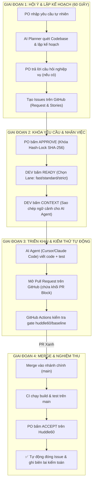
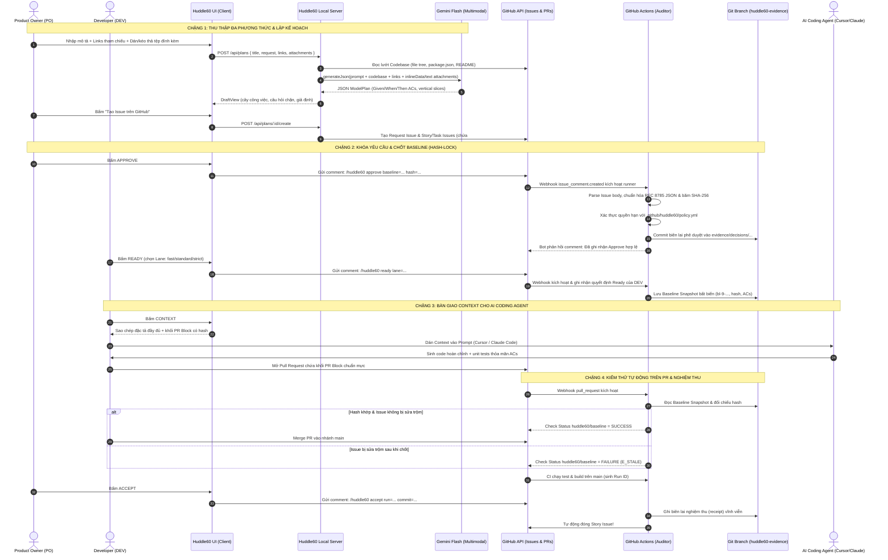

# Cẩm Nang Toàn Diện về Quy Trình Vận Hành Huddle60 (AI-DLC Workflow)

Tài liệu này tổng hợp toàn bộ **quy trình vận hành từ đầu đến cuối (End-to-End Workflow)** của giao thức **AI-DLC (AI Development Life Cycle)** được thực thi bởi công cụ **Huddle60**.

---

## 1. Bản Đồ Tổng Quan Quy Trình (The 60-Second Huddle & Delivery Flow)



---

## 2. Kiến Trúc Dòng Chảy Dữ Liệu (Data Flow Architecture)

Huddle60 vận hành theo kiến trúc **Zero-Database (Không cơ sở dữ liệu riêng)**: Toàn bộ trạng thái, yêu cầu, quyết định và bằng chứng kiểm toán được lưu trữ phân tán trực tiếp trên **GitHub (Issues, PRs, Comments và Git Evidence Branch)**.

### 2.1. Sơ Đồ Tuần Tự Toàn Diện (End-to-End Data Flow)



---

### 2.2. Chi Tiết Các Gói Dữ Liệu Trong Từng Chặng (Payload Breakdown)

| Chặng | Nguồn phát | Đích đến | Dạng dữ liệu (Payload) | Mục đích nghiệp vụ |
| :--- | :--- | :--- | :--- | :--- |
| **1. Thu thập đa phương thức** | PO Browser | Local Server | `POST /api/plans`<br>• `request`: Văn bản tự nhiên<br>• `links`: Mảng link tham chiếu (Figma, Docs, Swagger, PRD)<br>• `attachments`: Mảng Base64 (Ảnh, PDF, CSV, TXT, Markdown) | Truyền toàn bộ ngữ cảnh trực quan, tài liệu và đề bài của PO lên server xử lý. |
| **2. Codebase & Doc-Aware Prompt** | Local Server | Gemini API | `generateContent`<br>• `systemInstruction`: Quy tắc Vertical Slice & AC<br>• `codebase_context`: Cấu trúc cây thư mục repo<br>• `inlineData`: Binary của ảnh và PDF<br>• `text`: Trích xuất bảng CSV/văn bản | Cho phép AI thấu hiểu cả kiến trúc code hiện có lẫn tài liệu đặc tả để sinh AC chuẩn xác. |
| **3. Lưu trữ GitHub Issue** | Local Server | GitHub API | `POST /repos/{owner}/{repo}/issues`<br>• `body`: Chứa các section chuẩn hóa (`Goal`, `Scope`, `Acceptance Criteria`, `Tham chiếu kỹ thuật`: Links & Attachments) | Sử dụng GitHub Issue làm kho dữ liệu chính (Single Source of Truth), không cần database riêng. |
| **4. Khóa Hash-Lock** | GitHub Actions | Git Branch `huddle60-evidence` | • Snapshot chuẩn hóa theo **RFC 8785** (JCS)<br>• Khóa băm `contentHash: sha256(...)`<br>• Biên lai quyết định có chữ ký actor | Đảm bảo tính toàn vẹn (Immutability): Mọi hành vi sửa đổi yêu cầu sau lưng đều bị phát hiện ngay lập tức. |
| **5. Bàn giao Context** | Huddle60 UI | AI Coding Agent (Cursor / Claude) | Clipboard Text:<br>• Bản đặc tả nghiệp vụ & AC<br>• Khối `<!-- BEGIN HUDDLE60 -->...<!-- END HUDDLE60 -->`<br>• Link Figma & tài liệu kỹ thuật | Cung cấp ngữ cảnh đầy đủ, chặt chẽ để AI code đúng mục tiêu và vượt qua gate kiểm định. |
| **6. Kiểm thử PR Gate** | GitHub Actions | GitHub PR Status | `POST /repos/.../statuses/{sha}`<br>• `state: "success" \| "failure"`<br>• `context: "huddle60/baseline"` | Cổng chặn merge (Status Check): Chỉ cho phép merge code khi đáp ứng đúng baseline đã chốt. |
| **7. Biên lai nghiệm thu** | GitHub Actions | Git Branch & Issue | • Ghi file `evidence/decisions/...`<br>• `PATCH /repos/.../issues/{id}` (`state: "closed"`) | Khép kín vòng đời tính năng tự động và lưu vết kiểm toán vĩnh viễn trên Git tree. |

---

## 3. Vai Trò & Phân Quyền Trong Dự Án (RBAC)

Chính sách phân quyền được lưu minh bạch tại tệp `.github/huddle60/policy.yml` trên GitHub:

| Vai trò | Ký hiệu | Trách nhiệm chính | Quyền hạn trên Huddle60 |
| :--- | :---: | :--- | :--- |
| **Product Owner** | 👑 `po` | Định hình sản phẩm, chốt yêu cầu nghiệp vụ, nghiệm thu giá trị bàn giao. | • Bấm **Approve** (Duyệt yêu cầu).<br>• Bấm **Accept** (Nghiệm thu đóng Story).<br>• Tạo Request Issue ban đầu. |
| **Developer** | 💻 `dev` | Đảm bảo tính khả thi kỹ thuật, nhận việc, phối hợp cùng AI Agent code và test. | • Bấm **Ready** (Xác nhận sẵn sàng code).<br>• Chọn luồng triển khai (Lane).<br>• Sao chép **Context** cho AI Agent.<br>• Chỉnh sửa Spec kỹ thuật. |
| **Maintainer** | 🛡️ `maintainer`| Quản trị dự án, thiết lập hạ tầng CI/CD và chính sách bảo mật. | • Cập nhật danh sách thành viên PO/DEV.<br>• Khởi tạo hạ tầng AI-DLC (`init`).<br>• Cấu hình nhánh bằng chứng. |

---

## 4. Vòng Đời Chi Tiết Của Các Loại Issue

Trong một tính năng được tạo bởi Huddle60, luôn có sự phân định rạch ròi giữa 3 cấp độ:

```
[Request #8] Yêu cầu gốc của PO (Container)
  └── [Story #9] Lát cắt dọc hoàn chỉnh (Vertical Testable Slice)
        ├── [Task A] Kịch bản người dùng độc lập 1 (nếu cần chia nhỏ)
        └── [Task B] Kịch bản người dùng độc lập 2 (nếu cần chia nhỏ)
```

### 4.1. Request Issue (Yêu cầu gốc)
* **Mục đích:** Là nơi lưu lại đề bài ý tưởng ban đầu của PO (gắn nhãn `huddle60:request`).
* **Trạng thái:** Mở xuyên suốt quá trình thực thi các Story con.
* **Thời điểm đóng:** Đóng khi **toàn bộ các Story con sinh ra từ nó đã được PO nghiệm thu (`Accept`)**.

### 4.2. Story Issue (Lát cắt dọc tính năng - Vertical Slice)
* **Mục đích:** Đơn vị bàn giao giá trị cốt lõi, gắn nhãn `type:story`, chứa đầy đủ:
  * `Goal` (Mục tiêu) & `Scope` (Phạm vi).
  * `Acceptance Criteria` (AC dạng `Given... When... Then...`).
  * `Verification Notes` & `Risk Notes`.
* **Vòng đời 4 trạng thái:**
  1. `awaiting-approval` (Chờ PO duyệt): Hiển thị nút **Approve**.
  2. `awaiting-ready` (Chờ DEV xác nhận): Hiển thị nút **Ready**.
  3. `in-progress` (Đang triển khai): Đang có PR hoặc đang được code.
  4. `closed` (Đã hoàn tất): Tự động đóng sau khi PO bấm **Accept**.

### 4.3. Task Issue (Kịch bản con - Sub-scenario)
* **Mục đích:** Chỉ sinh ra khi Story quá lớn cần chia thành các kịch bản độc lập (gắn nhãn `type:task`).
* **Thời điểm đóng:** Tự động đóng khi Pull Request tương ứng của Task đó merge vào `main` (qua từ khóa `Fixes #task_number`).

---

## 5. Chi Tiết Từng Bước Triển Khai (Step-by-Step Execution)

### Bước 1: PO Nhập Yêu Cầu & Tài Liệu Thiết Kế (Universal Links & Attachments)
* PO vào tab **Lập kế hoạch**.
* Gõ tiêu đề và mô tả yêu cầu nghiệp vụ.
* *(Tùy chọn đa phương thức)*:
  * Nhập danh sách **Tài liệu & Liên kết tham chiếu**: Link Figma, Google Docs, Notion, Confluence, Swagger API, PRD (mỗi link 1 dòng).
  * Đính kèm tệp phân tích bằng cách **kéo thả file**, chọn file hoặc **dán trực tiếp (`Ctrl+V` / `Cmd+V`)**: Hỗ trợ ảnh mockup (PNG/JPG/WebP), tài liệu PDF, bảng dữ liệu CSV, tệp Markdown/TXT (tối đa 10 tệp, 10MB/tệp).

### Bước 2: AI Codebase & Multimodal Planner Phân Tích
* Huddle60 tự động đọc lướt cấu trúc repository hiện có (`package.json`, cấu trúc cây file).
* Gemini phân tích đồng thời bản vẽ thiết kế, tài liệu PDF, bảng dữ liệu CSV và yêu cầu tự nhiên:
  * Trích xuất các trường dữ liệu, cấu trúc UI, tương tác và quy tắc nghiệp vụ vào các tiêu chí **Acceptance Criteria (AC dạng Given/When/Then)** rõ ràng.
  * Nếu tính năng gọn gàng: Đề xuất đúng **1 Story hoàn chỉnh** (không sinh task con vụn vặt).
  * Nếu có điểm chưa rõ về nghiệp vụ: Nêu câu hỏi trong `openQuestions`.
  * Tuyệt đối **không hỏi PO về chi tiết kỹ thuật/codebase** (tự động đưa vào `assumptions`).

### Bước 3: Hội Ý 60 Giây & Tạo Issue
* PO trả lời các câu hỏi nghiệp vụ (nếu có).
* Bấm **Tạo Issue trên GitHub**: Huddle60 tạo Request Issue và các Story/Task Issues trực tiếp trên GitHub repository.
* Danh mục các link tham chiếu và tệp đính kèm đã phân tích được lưu giữ chuẩn hóa trong mục `### Tham chiếu kỹ thuật` của Issue và truyền trọn vẹn vào khối **Context** cho AI coding agent.

### Bước 4: PO Phê Duyệt (Approve - Khóa Hash-Lock)
* PO vào tab **Công việc**, đọc lại các tiêu chí nghiệm thu AC.
* Bấm **Approve**: 
  * App gửi comment: `/huddle60 approve baseline=bl-9-... hash=sha256:...`.
  * GitHub Actions kiểm tra tính hợp lệ và ghi biên lai vào nhánh `huddle60-evidence`.
  * Nội dung yêu cầu chính thức bị **"khóa cứng" (Hash-locked)**. Nếu ai sửa đổi dù chỉ 1 ký tự, hệ thống sẽ báo đỏ ngay.

### Bước 5: DEV Tiếp Nhận (Ready)
* DEV chọn luồng triển khai (**Lane**):
  * `fast`: Dành cho thay đổi nhỏ, không cần PO duyệt lại.
  * `standard`: Luồng chuẩn, yêu cầu test unit & E2E.
  * `strict`: Luồng nghiêm ngặt khi chạm vào các file nhạy cảm (`sensitive_paths`).
* DEV bấm **Ready**: Trạng thái chuyển sang `in-progress`.

### Bước 6: Lập Trình Cùng AI Coding Agent (Cursor / Claude Code)
* DEV bấm nút **Context**: Huddle60 sao chép toàn bộ đặc tả chuẩn mực vào clipboard:
  * Mục tiêu, phạm vi, Given/When/Then AC.
  * Gợi ý tên branch quy chuẩn (`feat/...`).
  * Khối PR block bảo mật.
* DEV dán vào Cursor / Claude Code / Copilot để AI Agent viết code và test tự động.

### Bước 7: Mở Pull Request & Kiểm Thử Tự Động
* DEV mở PR trên GitHub, trong phần mô tả có dán khối PR block:
  ```text
  <!-- BEGIN HUDDLE60 -->
  issue: 9
  baseline: bl-9-e188424e
  hash: sha256:7636bca2d5d9dd0deccceb067a67016f4774c81b5a8ccb707f08a05367a7ef77
  criteria: AC-01, AC-02, AC-03, AC-04
  <!-- END HUDDLE60 -->
  ```
* GitHub Actions chạy kiểm tra tự động `huddle60/baseline`:
  * ✅ Nếu hash trùng khớp và đúng DEV: Trả kết quả xanh lá `Success`.
  * ❌ Nếu có ai sửa trộm Issue: Check báo đỏ `Failure (E_STALE)` và chặn merge code.

### Bước 8: Merge Vào Nhánh Chính & Build Staging
* Sau khi code review và test pass, PR được merge vào `main`.
* GitHub Actions kích hoạt pipeline build và deploy lên môi trường staging.

### Bước 9: PO Nghiệm Thu (Accept) & Đóng Issue
* Trên giao diện Huddle60, nút **Accept** xuất hiện sáng lên cạnh Story.
* PO kiểm tra thực tế trên bản build vừa merge.
* PO bấm **Accept**:
  * Huddle60 gửi lệnh `/huddle60 accept run=<id> commit=<sha>`.
  * GitHub Actions xác nhận và **tự động đóng Story Issue**.
  * Bằng chứng nghiệm thu vĩnh viễn được lưu trên Git.

---

## 6. Bảng Tổng Hợp Điều Kiện Đóng Issue

| Loại Issue | Ai đóng? | Đóng khi nào? | Cơ chế đóng |
| :--- | :--- | :--- | :--- |
| **Story Issue** | GitHub Actions | Khi PO kiểm tra bản build trên `main` và bấm **Accept**. | **Tự động 100%** thông qua bot GitHub Actions. |
| **Task Issue** (nếu có) | GitHub | Khi Pull Request của Task đó được merge vào `main`. | Tự động thông qua từ khóa `Fixes #task_number` trong PR. |
| **Request Issue** | PO / Quản trị | Khi toàn bộ các Story con sinh ra từ nó đã đóng hoàn tất. | Đóng thủ công hoặc thông qua comment nghiệm thu tổng kết. |

---

## 7. Các Nguyên Tắc "Bất Di Bất Dịch" Của AI-DLC

1. **Zero-Database (Không Cơ sở dữ liệu riêng):** Toàn bộ dữ liệu nằm 100% trên GitHub (Issues, PRs, Git Evidence branch).
2. **Hash-Lock RFC 8785:** Không ai có thể âm thầm thay đổi yêu cầu sau lưng lập trình viên mà không bị phát hiện.
3. **One-Piece Flow (Làm dứt điểm từng lát cắt):** Không đưa hàng loạt task vào `In Progress`. Làm xong kịch bản nào, test xanh, merge và release kịch bản đó rồi mới làm tiếp.
4. **Codebase-Aware Planning:** AI tự động hiểu hiện trạng code của dự án để đưa ra kế hoạch thực tế nhất, giải phóng PO khỏi những bối rối kỹ thuật.

