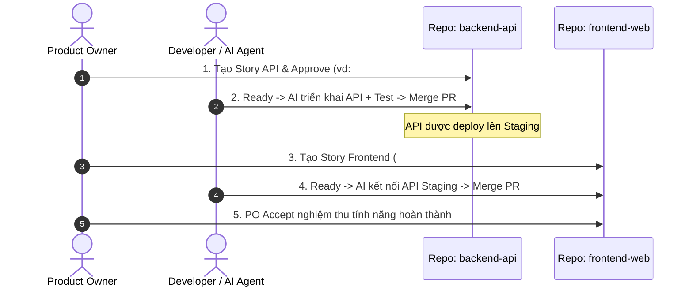

# Xu Hướng Monorepo trong Kỷ Nguyên AI Engineering & Chiến Lược Hỗ Trợ Của Huddle60 (AI-DLC)

Tài liệu này phân tích sâu về **sự dịch chuyển tất yếu từ Multi-repo sang Monorepo** khi đội ngũ phần mềm cộng tác với các AI Coding Agent (Cursor, Claude Code, GitHub Copilot, SWE-bench agents), bản chất của **Acceptance Criteria (AC)** trong giao thức AI-DLC, và **chiến lược kiến trúc của Huddle60** nhằm hỗ trợ cả dự án Monorepo lẫn Multi-repo.

---

## 1. Bản Chất của Acceptance Criteria (AC): Nghiệp Vụ vs Kỹ Thuật

Một thắc mắc kinh điển khi tiếp cận chuẩn AI-DLC:
> *"Các tiêu chí nghiệm thu (AC) chỉ là yêu cầu nghiệp vụ đơn thuần, không dính dáng gì đến kỹ thuật đúng không?"*

### 1.1. Góc nhìn Nghiệp vụ (PO / Business): Ngôn ngữ Hành vi
* AC được viết bằng ngôn ngữ hành vi (`Given... When... Then...`), mô tả hành vi quan sát được từ bên ngoài (Black-box Behavior):
  * **Given (Bối cảnh):** Trạng thái ban đầu của hệ thống hoặc người dùng.
  * **When (Hành động):** Tác vụ người dùng thực hiện hoặc sự kiện kích hoạt.
  * **Then (Kết quả):** Phản hồi quan sát được từ hệ thống.
* **Nguyên tắc vàng:** AC **tuyệt đối không chỉ định chi tiết triển khai mã nguồn** (không viết: *"Dùng hook `useEffect`"*, *"Chạy query `SELECT * FROM users`"* hay *"Lưu token vào Redis"*).
  * *Lý do:* Nếu ghi chi tiết kỹ thuật vào AC, khi đội ngũ tối ưu hóa kiến trúc hoặc chuyển đổi thư viện, AC sẽ lập tức bị lỗi thời, gây tắc nghẽn quy trình nghiệm thu.

### 1.2. Góc nhìn Kỹ thuật (DEV & AI Agent): Bản thiết kế của Test Tự động
* Mặc dù được viết bằng ngôn ngữ tự nhiên, **AC chính là "hợp đồng kiểm thử số" (Executable Specification)**.
* Khi DEV hoặc AI Coding Agent nhận ngữ cảnh (Context) từ Huddle60, AI sẽ chuyển đổi **1-1** từng tiêu chí AC thành một kịch bản kiểm thử tự động (E2E Test hoặc Integration Test):

```typescript
// AC-01: Given người dùng khởi động ứng dụng,
//        When màn hình tải hoàn tất,
//        Then giao diện hiển thị thông điệp 'Hello' ở vị trí trung tâm.

test("AC-01: Displays centered Hello message on app startup", async () => {
  await app.launch();
  const greeting = await screen.findByRole("heading", { name: /hello/i });
  expect(greeting).toBeVisible();
  expect(greeting).toHaveClass("text-center");
});
```

### 1.3. Nơi lưu trữ thông tin thuần kỹ thuật
Trong mẫu đặc tả Issue của AI-DLC, các lưu ý kỹ thuật không bị bỏ qua mà được đặt đúng vị trí:
* **Criteria (AC-01, AC-02):** Tiêu chuẩn hành vi nghiệm thu.
* **Technical & Verification Notes:** Hướng dẫn kỹ thuật dành cho DEV/AI (ví dụ: *"Sử dụng endpoint `/api/v2/greet`"*, *"Header yêu cầu `Bearer token`"*, *"Cần tối ưu LCP dưới 1.2s"*).
* **Risk Notes:** Cảnh báo an toàn (bảo mật, quyền hạn, dữ liệu người dùng).

---

## 2. Vì Sao Kỷ Nguyên AI Coding Đang Thúc Đẩy Mạnh Mẽ Xu Hướng Monorepo?

### 2.1. Sự khác biệt căn bản giữa Lập trình viên truyền thống và AI Coding Agent

| Tiêu chí | Lập trình viên truyền thống (Human) | AI Coding Agent (Cursor / Claude Code) |
| :--- | :--- | :--- |
| **Phân công công việc** | Thường chia theo chuyên môn: Frontend DEV riêng, Backend DEV riêng, DevOps riêng. | **Mặc định là Full-stack**: Sửa schema DB, viết API, gắn UI và viết test cùng một lúc. |
| **Phạm vi tác vụ** | Dễ bị giới hạn bởi repo mình phụ trách. | Có khả năng đọc hiểu ngữ cảnh liên package cực nhanh nếu nằm chung workspace. |
| **Rào cản lớn nhất** | Khó làm quen với codebase quá đồ sộ. | Bị nghẽn bởi sự **phân mảnh ngữ cảnh (Context Fragmentation)** giữa các repo rời rạc. |

### 2.2. Nghẽn cổ chai của Multi-repo khi làm việc với AI

Khi một dự án tách thành 2 repo riêng biệt (`company/backend-api` và `company/frontend-web`):
1. **Phân mảnh ngữ cảnh (Context Blindness):** AI ở repo frontend không đọc được định nghĩa types, schema DTO mới nhất ở repo backend, dẫn đến AI phải "đoán" cấu trúc API và sinh mã sai lệch.
2. **Quy trình kéo dài gấp đôi:**
   * DEV/AI phải mở PR #1 trên repo Backend -> chờ CI chạy -> merge PR.
   * Chờ deploy API lên môi trường Dev/Staging.
   * DEV/AI chuyển sang repo Frontend, mở PR #2 -> chờ CI -> merge PR.
3. **Mất tính chất "Vertical Testable Slice":** PR #1 của Backend không có giao diện để PO bấm thử; PR #2 của Frontend nếu merge trước sẽ làm hỏng ứng dụng vì thiếu API.

### 2.3. Sức mạnh vượt trội của Monorepo với AI-DLC

Khi gom Backend, Frontend và Shared Types vào chung một **Monorepo**:
* **1 Prompt = 1 Lát cắt dọc hoàn chỉnh (End-to-End Vertical Slice):**
  Trong một lần chạy duy nhất, AI Agent có thể:
  1. Thêm bảng trong Database migration.
  2. Tạo API endpoint và xuất TypeScript type trong package `@company/api`.
  3. Import type đó vào giao diện `@company/web` để hiển thị.
  4. Viết bài test E2E kiểm thử từ đầu đến cuối.
* **1 Single Pull Request duy nhất:** Toàn bộ tính năng từ giao diện đến server được kiểm thử xanh (Green Build), review và merge trong 1 PR.
* **Zero Breaking Changes:** Khi đổi tên trường dữ liệu trong API, trình biên dịch TypeScript và bài test E2E sẽ bắt ngay mọi component frontend bị ảnh hưởng trước khi code kịp merge vào nhánh chính.

---

## 3. Kiến Trúc Hỗ Trợ Dự Án Monorepo trong Huddle60

Huddle60 được thiết kế để trở thành **nền tảng điều phối AI-DLC tối ưu nhất cho Monorepo**:

### 3.1. Cấu trúc Monorepo Khuyên Dùng (Turborepo / pnpm / Bun)

```text
my-monorepo/
├── .github/
│   ├── workflows/
│   │   ├── huddle60-pr.yml        # CI kiểm tra hash-lock & evidence
│   │   └── build.yml              # CI build & test tự động
│   └── huddle60/
│       └── policy.yml             # Chính sách phân quyền RBAC & Lanes
├── apps/
│   ├── web/                       # Ứng dụng Frontend (React / Next.js)
│   └── api/                       # Dịch vụ Backend (Node.js / Go / FastAPI)
├── packages/
│   ├── shared-types/              # DTO, Schema (Zod / TypeScript types)
│   └── ui-kit/                    # Thư viện UI chung
└── package.json
```

### 3.2. Cấu hình Chính sách (`.github/huddle60/policy.yml`) dành cho Monorepo

Huddle60 cho phép bảo vệ các gói dùng chung và phân định luồng duyệt thông minh thông qua `sensitive_paths`:

```yaml
version: 1

roles:
  po:
    - login: tadev999
      id: 286027161
  dev:
    - login: tadev999
      id: 286027161
  maintainer:
    - login: tadev999
      id: 286027161

# Đường dẫn nhạy cảm: Chạm vào gói dùng chung bắt buộc phải đi luồng Strict
sensitive_paths:
  - "packages/shared-types/**"
  - ".github/workflows/**"
  - ".github/huddle60/**"

lanes:
  # Luồng nhanh cho các chỉnh sửa UI nhỏ lẻ
  fast:
    requiresPoApproval: false
    evidence:
      - lint
      - typecheck

  # Luồng tiêu chuẩn cho tính năng sản phẩm thông thường
  standard:
    requiresPoApproval: true
    evidence:
      - test-unit
      - test-e2e

  # Luồng kiểm duyệt nghiêm ngặt khi chạm vào Shared Types hoặc Hạ tầng
  strict:
    requiresPoApproval: true
    evidence:
      - test-unit
      - test-e2e
      - security-scan
```

---

## 4. Cách Vận Hành Khi Dự Án Vẫn Là Multi-repo (Tách Repo)

Đối với các tổ chức đã chia sẵn 2 repo riêng (`frontend` và `backend`), Huddle60 hỗ trợ chuẩn chỉnh theo nguyên lý **Contract-First**:



1. **Sử dụng Repository Switcher của Huddle60:**
   * Người dùng dễ dàng chuyển đổi giữa các repo chỉ với 1 click ở góc trên ứng dụng.
2. **Khóa phụ thuộc (`blockedBy`):**
   * Issue trên repo Frontend ghi rõ phụ thuộc: `blockedBy: company/backend-api#12`.
   * Giao thức Huddle60 tự động khóa, **không cho phép chuyển task Frontend sang `Ready`** chừng nào Issue #12 trên Backend chưa được đóng/hoàn tất.

---

## 5. Tổng Kết & Khuyến Nghị Thực Hành

1. **Nghiệp vụ (PO) và Kỹ thuật (DEV):**
   * PO chỉ cần tập trung vào **Giá trị người dùng** thông qua tiêu chí **Given / When / Then**.
   * DEV và AI Agent dùng chính tiêu chí này làm **bản thiết kế kiểm thử tự động**, biến nó thành code thực thi có độ tin cậy tuyệt đối.
2. **Ưu tiên kiến trúc Monorepo:**
   * Nếu bạn khởi tạo một dự án mới hoặc có khả năng tái cấu trúc, hãy **ưu tiên Monorepo**. Đây là chìa khóa vàng giúp AI Coding Agent phát huy 100% năng lực tự hành (full-stack autonomous coding).
3. **Multi-repo có trật tự:**
   * Nếu giữ mô hình Multi-repo, hãy áp dụng quy trình **Contract-First** cùng tính năng liên kết phụ thuộc `blockedBy` của Huddle60 để đảm bảo Frontend và Backend luôn ăn khớp, không bao giờ deploy code lỗi.

