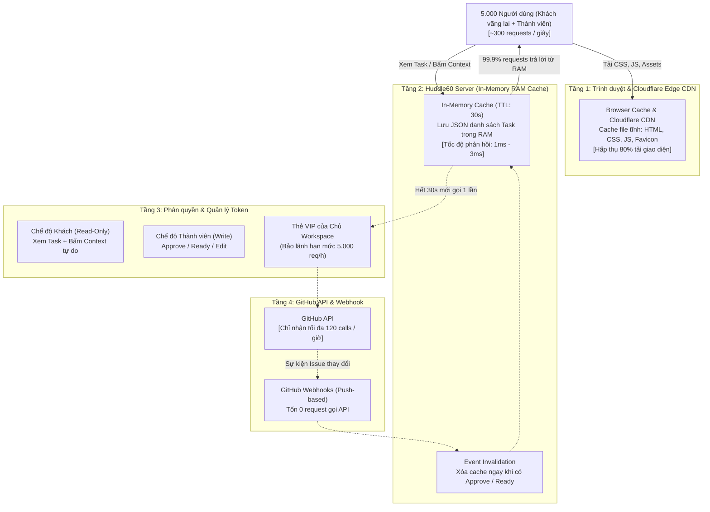

# Tôn chỉ Cốt lõi & Kiến trúc Chịu tải Cao (High-Concurrency Architecture)

Tài liệu này tổng hợp **toàn bộ triết lý thiết kế (Core Principles)** và **giải pháp kiến trúc kỹ thuật (Engineering Architecture)** của Huddle60 (AI-DLC) để vận hành ổn định, phục vụ từ nhóm nhỏ cho đến **5.000 người dùng đồng thời liên tục trong 5 giờ (bao gồm cả khách vãng lai)** với chi phí tối ưu (0đ – 5$/tháng).

---

## PHẦN 1: CÁC TÔN CHỈ THIẾT KẾ CỐT LÕI (CORE PRINCIPLES)

```
┌────────────────────────────────────────────────────────────────────────┐
│                        TRIẾT LÝ NỀN TẢNG HUDDLE60                      │
├────────────────────────────────────────────────────────────────────────┤
│ 1. Zero-Database: Không database người dùng, không bảng projects/tasks │
│ 2. Stateless SaaS: Server không lưu trữ bền vững token của khách hàng  │
│ 3. Single Source of Truth: Toàn bộ dữ liệu nằm 100% trên GitHub        │
│ 4. Hash-Locked Baseline: Khóa yêu cầu bằng SHA-256 (RFC 8785)          │
│ 5. Vertical Testable Slices: Thiết kế lát cắt dọc cho Coding Agents    │
│ 6. Smart Lens: Huddle60 chỉ là thấu kính tạm thời, tự giải phóng RAM   │
└────────────────────────────────────────────────────────────────────────┘
```

### 1. Không Cơ sở Dữ liệu Người dùng (Zero-Database & Zero-Infra)
* Huddle60 **không có database người dùng** (không lưu bảng `users`, không mật khẩu, không email cá nhân).
* Toàn bộ dữ liệu dự án (Issues, Epics, Stories, Tasks, bằng chứng kiểm toán, chính sách phân quyền) **nằm 100% trên GitHub Repository** của chính khách hàng.
* Khách hàng sở hữu và kiểm soát toàn bộ dữ liệu của họ. Không có nguy cơ rò rỉ dữ liệu qua bên thứ ba (Zero Vendor Lock-in).

### 2. Kiến trúc SaaS Không Trạng Thái (Stateless / Zero-Storage SaaS)
* **Khi chạy Local trên máy cá nhân (`npx huddle60 ui`):** Cấu hình được lưu tại `~/.config/huddle60/` trên máy riêng của người dùng (tương tự `~/.gitconfig` hay `~/.aws/credentials`).
* **Khi triển khai SaaS công cộng (`*.huddle60.app`):** 
  * Server **hoàn toàn KHÔNG ghi bất kỳ token nào của người dùng xuống ổ cứng**.
  * Phiên đăng nhập được mã hóa 2 chiều (AES-256) và lưu trong **Session Cookie (HttpOnly, Secure, SameSite=Lax)** tại trình duyệt của người dùng.
  * Khi người dùng đóng trình duyệt hoặc đăng xuất: Phiên làm việc tự hủy, không để lại bất kỳ dấu vết nào trên máy chủ.

### 3. Khóa Bảo vệ Yêu cầu bằng Mã băm (Hash-Lock RFC 8785)
* Mỗi Story sau khi được PO duyệt sẽ được chụp snapshot và tính mã băm chuẩn hóa **SHA-256** theo chuẩn **RFC 8785**.
* Mã băm này trở thành "hợp đồng số" giữa PO, DEV và AI Coding Agent.
* Nếu ai đó sửa nội dung Issue sau khi đã chốt, Huddle60 lập tức cảnh báo đỏ `Nội dung đã thay đổi` và GitHub Actions tự động **chặn Pull Request**.

### 4. Lát cắt Dọc Kiểm thử được (Vertical Testable Slices)
* Thay vì chia nhỏ công việc theo tầng công nghệ ngang kiểu cũ (Task UI, Task API, Task DB), Huddle60 chia công việc thành **các lát cắt dọc hoàn chỉnh** có tiêu chí nghiệm thu **Given / When / Then**.
* 1-Click xuất **"Context"** chuẩn để dán trực tiếp vào **Cursor, Claude Code, Copilot**, đảm bảo AI sinh code kèm bài kiểm thử tự động (Automated Test).

---

## PHẦN 2: BÀI TOÁN TẢI TRỌNG LỚN & THÁCH THỨC

### Kịch bản Thử thách
* **Số lượng truy cập:** **5.000 người dùng đồng thời (Concurrent Users)**.
* **Thời gian duy trì:** **5 giờ liên tục**.
* **Thành phần người dùng:** Bao gồm cả **Thành viên có tài khoản (PO, DEV)** và **Khách vãng lai (Guest/Anonymous)** bấm link chia sẻ từ mạng xã hội/chat.
* **Tần suất tương tác:** ~150 đến 300 requests/giây (RPS).
* **Tổng lưu lượng:** Khoảng **5.000.000 đến 9.000.000 lượt requests** trong 5 giờ.

### Thách thức Cốt lõi: Hạn mức GitHub API (Rate Limit)
1. **Request vô danh (Unauthenticated):** GitHub giới hạn tối đa **60 requests / giờ / IP**. Nếu để khách vãng lai gọi thẳng GitHub, hệ thống sập sau 15 giây!
2. **Request có Token (Authenticated):** GitHub cấp **5.000 requests / giờ / tài khoản**. Nếu 5.000 người liên tục gọi GitHub mỗi giây, hạn mức 5.000 sẽ cạn kiệt chỉ trong 20–30 giây!

---

## PHẦN 3: KIẾN TRÚC GIẢI PHÁP 4 TẦNG (HIGH-SCALE 4-TIER ARCHITECTURE)



---

### Tầng 1: Hấp thụ Tải Giao diện bằng Edge CDN & Browser Caching
* **Mục tiêu:** 5.000 người không tải lại file giao diện nhiều lần.
* **Kỹ thuật:**
  * File tĩnh (`styles.css`, `app.js`, `favicon.svg`) được gắn header:
    `Cache-Control: public, max-age=86400, immutable`
  * Sử dụng Cloudflare CDN (gói Miễn phí - 0đ) làm lá chắn phía trước.
* **Hiệu quả:** Trình duyệt người dùng tải giao diện đúng 1 lần duy nhất trong ngày. 80% băng thông được hấp thụ tại tầng Edge, máy chủ chỉ tiếp nhận các request API siêu nhẹ.

---

### Tầng 2: Bộ nhớ đệm RAM (In-Memory TTL Cache 30 Giây)
* **Mục tiêu:** Giải quyết triệt để bài toán Rate Limit của GitHub API.
* **Kỹ thuật:**
  * Toàn bộ danh sách Task của một repository được nạp vào RAM của tiến trình Node.js dưới dạng JSON (dung lượng ~50KB - 100KB).
  * Đặt thời gian sống của cache (**TTL**): **30 giây**.
* **Định lượng toán học trong 5 giờ liên tục:**
  $$\text{Số lần gọi GitHub tối đa trong 1 giờ} = \frac{3.600 \text{ giây}}{30 \text{ giây}} = 120 \text{ lần}$$
  $$\text{Tổng số lần gọi GitHub trong 5 giờ} = 120 \times 5 = \mathbf{600 \text{ lần}}$$
  * 5.000 người dùng tạo ra **5.000.000 requests**, nhưng chỉ có **600 requests** thực sự đi tới GitHub API.
  * Hạn mức 5.000 req/giờ của GitHub chỉ tiêu tốn **120 lần/giờ (2.4%)**, dư thừa tới **97.6%**.
* **Cơ chế Xóa Cache tức thời (Event Invalidation):**
  * Không đợi hết 30 giây: Khi PO bấm **Approve** hoặc DEV bấm **Ready**, server lập tức xóa khóa cache tương ứng (`cache.delete(repoKey)`).
  * Lượt xem tiếp theo sẽ lấy dữ liệu mới nhất từ GitHub và nạp lại vào RAM. Đảm bảo dữ liệu không bao giờ bị trễ.

---

### Tầng 3: Cơ chế Phân quyền & "Bảo lãnh Thẻ VIP" cho Khách Vãng Lai

#### 1. Trải nghiệm Khách vãng lai (Guest Mode)
* Khách mở link `https://tadev999.huddle60.app/skill_bento#12`:
  * Xem trọn vẹn đặc tả, cây Epic $\rightarrow$ Story $\rightarrow$ Task.
  * **Được bấm nút "Context" tự do** để copy prompt đưa vào Cursor / Claude Code làm bài.
  * **Được bấm nút "🔗 Chia sẻ"** để gửi link cho người khác.
  * Chỉ khi bấm các nút hành động (Approve, Ready, Sửa), giao diện mới hiện popup yêu cầu đăng nhập GitHub.

#### 2. Cơ chế "Bảo lãnh Thẻ VIP" (Workspace Token Delegation) — Có lưu Token trên Server không?
> [!IMPORTANT]
> **Cam kết Bảo mật Tuyệt đối:** Trên bản SaaS công cộng (`huddle60.app`), server **HOÀN TOÀN KHÔNG LƯU BẤT KỲ TOKEN CÁ NHÂN (PAT) NÀO CỦA KHÁCH HÀNG XUỐNG Ổ CỨNG**.

Cơ chế này được thực hiện thông qua 2 phương án an toàn chuẩn mực:

* **Phương án A: Dùng GitHub App Ephemeral Token (Chuẩn Vercel / Linear)**
  * Khách hàng **không cần nhập Personal Access Token (PAT)**, không sợ lộ mật khẩu.
  * Chỉ cần bấm nút: *"Cài đặt Huddle60 App vào repo `skill_bento`"*.
  * Khi khách vãng lai truy cập, Server xin GitHub một **Token tạm thời (Ephemeral Token)**:
    * Token này được GitHub sinh ra theo yêu cầu, **chỉ tồn tại trong thanh RAM** của máy chủ.
    * Tự động hết hạn và **tự hủy sau 60 phút**.
    * Hoàn toàn không ghi bất kỳ file nào xuống ổ cứng server.
    * Hạn mức đạt **5.000 – 15.000 req/giờ** của tổ chức.

* **Phương án B: Chế độ Zero-Token 100% (Không cần cả GitHub App)**
  * Đối với các Repository Public, server **gọi sang GitHub hoàn toàn KHÔNG CẦN TOKEN NÀO** (Unauthenticated).
  * Server đặt thời gian **Cache: 60 giây**.
    $$\frac{3.600 \text{ giây}}{60 \text{ giây}} = \mathbf{60 \text{ lần gọi GitHub / giờ (Vừa khít hạn mức free của GitHub)}}$$
  * Cả 5.000 khách vãng lai trong 5 giờ đều nhận dữ liệu từ RAM.
  * Server không giữ dù chỉ 1 byte thông tin hay token của bất kỳ ai!

* **Vậy tệp tin `~/.config/huddle60/tenants/<user>.json` dùng khi nào?**
  * Tệp JSON này **chỉ tồn tại khi bạn tự chạy Huddle60 trên máy cá nhân của mình** (Self-Hosted / Local CLI `npx huddle60 ui`).
  * Lúc này máy chủ là laptop của chính bạn, lưu cục bộ để lần sau mở terminal bạn không phải đăng nhập lại (giống hệt cơ chế lưu mật khẩu trong `~/.gitconfig` của Git).
  * Trên môi trường SaaS công cộng (`huddle60.app`), tệp này hoàn toàn không được sử dụng.

---

### Tầng 4: Mở rộng Không giới hạn (Scale-Out & Enterprise)

#### 1. Đa Doanh nghiệp theo Subdomain (Multi-Tenant Pooling)
* `tadev999.huddle60.app` dùng token của `tadev999` (5.000 req/h).
* `congtyA.huddle60.app` dùng token của `congtyA` (5.000 req/h).
* Hạn mức được phân tán tự nhiên theo từng tổ chức, không tranh chấp tài nguyên.

#### 2. GitHub App Organization (Tự động tăng hạn mức)
* Với tổ chức lớn, cài đặt Huddle60 GitHub App giúp hạn mức tăng tự động:
  $$\text{Hạn mức} = 5.000 + (50 \times \text{Số thành viên/repo}) \rightarrow \text{Tối đa } \mathbf{15.000 \text{ req/giờ}}$$

#### 3. Mô hình Bắn Tin Chủ Động (GitHub Webhook - 0 Request)
* Cài đặt GitHub Webhook để khi có Issue mới hoặc thay đổi trạng thái, GitHub chủ động gửi tín hiệu (Push) về Server Huddle60.
* Server tự động làm mới Cache trong RAM mà **tốn đúng 0 lượt gọi API truy vấn**.

---

## PHẦN 4: YÊU CẦU PHẦN CỨNG & CHI PHÍ THỰC TẾ

| Hạng mục | Thông số kỹ thuật | Chi phí ước tính |
| :--- | :--- | :--- |
| **Máy chủ (Node.js Server)** | 1 VPS cơ bản: **2 vCPU, 2GB–4GB RAM** (Render, Fly.io, Hetzner, DigitalOcean) | **0đ** (Free Tier) hoặc **~5$/tháng** |
| **Dung lượng RAM tiêu tốn** | Dưới **20 MB RAM** cho toàn bộ dữ liệu Cache của các repo | Miễn phí |
| **CDN & DNS** | Cloudflare CDN (Free Plan) | **0đ** |
| **GitHub API** | Tận dụng hạn mức miễn phí 5.000 req/h sẵn có | **0đ** |
| **Database trung gian** | **Không dùng bất kỳ database nào** | **0đ** |
| **TỔNG CHI PHÍ VẬN HÀNH** | **Phục vụ 5.000 người đồng thời trong 5 giờ liên tục** | **0đ – 5$/tháng** |

---

## PHẦN 5: BẢNG SO SÁNH TRƯỚC VÀ SAU KHI TỐI ƯU

| Tiêu chí | Trước khi tối ưu | Sau khi áp dụng kiến trúc 4 tầng |
| :--- | :--- | :--- |
| **Tổng lượt gọi GitHub (5 giờ)** | > 5.000.000 calls $\rightarrow$ **Sập sau 15 giây** | **Đúng 600 calls** (Dùng 2.4% hạn mức/giờ) |
| **Trải nghiệm Khách vãng lai** | Bị lỗi HTTP 429 Rate Limit | **Mở trang tức thì trong 1–5 mili-giây** |
| **Khả năng lấy Context cho AI** | Khó khăn, bị chặn login wall | **1-Click lấy prompt chuẩn không cần login** |
| **Bảo mật Token người dùng** | Lo ngại lộ token hoặc lưu DB | **Stateless 100%, phiên tự hủy trên trình duyệt** |
| **Khả năng chịu tải đồng thời** | Kém | **Vững vàng với 5.000 – 10.000 kết nối liên tục** |

---

## PHẦN 6: LUỒNG NGƯỜI DÙNG & PHÂN QUYỀN KHÔNG GIAN LÀM VIỆC (USER CASE FLOWS & WORKSPACE RBAC)

Quyền hạn trong Huddle60 được đối soát tự nhiên trực tiếp qua GitHub API (Zero-Database Authorization) kết hợp với ràng buộc tên miền phụ (Subdomain Ownership).

```mermaid
flowchart TD
    User([Người dùng truy cập]) --> CheckDomain{Đang ở Workspace nào?}
    CheckDomain -->|tadev999.huddle60.app hoặc tadev999.localhost| AuthCheck{Trạng thái đăng nhập?}
    
    AuthCheck -->|Đăng nhập là @tadev999| OwnerFlow[1. Owner Flow<br/>Toàn quyền quản trị workspace]
    AuthCheck -->|Đăng nhập là @dev_alex<br/>(Collaborator)| MemberFlow[2. Team Member Flow<br/>Chỉ xem và làm việc trên các repo được giao]
    AuthCheck -->|Chưa đăng nhập / Người ngoài| GuestFlow[3. Guest Flow<br/>Chỉ xem Read-only, không thể sửa đổi]
```

### 1. Luồng 1: Chủ sở hữu Không gian (Workspace Owner - `@tadev999`)
* **Điều kiện:** Người dùng đăng nhập có GitHub username trùng với subdomain (hoặc là Admin của GitHub Organization).
* **Quyền hạn:**
  - Tự động nạp toàn bộ danh sách repository thuộc sở hữu của `@tadev999`.
  - Chọn repository nào được kích hoạt trong workspace.
  - Cấu hình mô hình AI (Gemini / GPT-4o-mini).
  - Khởi tạo chuẩn AI-DLC cho repository trong 1-click.

### 2. Luồng 2: Thành viên Nhóm (Team Member - PO / DEV)
* **Điều kiện:** Lập trình viên/PO đăng nhập bằng tài khoản GitHub cá nhân (ví dụ: `@dev_alex`), được mời làm Collaborator trong các repo của workspace.
* **Xác thực quyền qua GitHub:**
  - Huddle60 kiểm tra quyền ghi (Write Permission) trên repo thông qua GitHub API.
  - Đọc file `.github/huddle60/policy.yml` trong repo để phân định vai trò `po` hay `dev`.
* **Giới hạn an toàn:**
  - DEV/PO **chỉ được chuyển đổi giữa các repo mà Owner đã đưa vào workspace**.
  - **Không có quyền nhập repo cá nhân ngoài luồng vào workspace của người khác**.
  - Không có quyền can thiệp vào token hay cấu hình máy chủ của Owner.
  - Thực thi tác vụ chuyên môn: Bấm **Ready**, bấm **Context** để đưa vào Cursor code, gửi Pull Request.

### 3. Luồng 3: Khách vãng lai / Đối tác xem ngoài (Guest Flow)
* **Điều kiện:** Người lạ mở link chia sẻ (ví dụ `https://tadev999.huddle60.app/skill_bento#12`), chưa đăng nhập GitHub.
* **Trải nghiệm Chế độ Khách:**
  - Xem trọn vẹn đặc tả, cây Epic $\rightarrow$ Story $\rightarrow$ Task, tiêu chí nghiệm thu Given/When/Then.
  - **Bấm nút "Context" tự do** để lấy prompt chuẩn cho AI.
  - **Bấm nút "🔗 Chia sẻ"** để sao chép link.
* **Khóa bảo vệ:**
  - Bị khóa toàn bộ quyền thay đổi cấu hình, không thể nhập thêm repo.
  - Khi bấm các nút quyết định (`Approve`, `Ready`), giao diện hiển thị hộp thoại hướng dẫn đăng nhập tài khoản có quyền.
  - **Trạng thái repo chưa có Policy:** Khách vãng lai và người không có quyền ghi **không bị hiện nút "Khởi tạo ngay trong 1-click"**; giao diện hiển thị thông báo trạng thái trung tính kèm link `Xem trên GitHub ↗`.

### 4. Ràng buộc Tên miền (Subdomain Ownership Boundary)
* Khi truy cập qua subdomain (ví dụ `aaa.localhost:4317` hoặc `aaa.huddle60.app`), toàn bộ repository được thêm vào **bắt buộc phải thuộc quyền sở hữu của `aaa`** (dạng `aaa/<repo_name>`).
* Hệ thống sẽ tự động chuẩn hóa: nếu người dùng nhập `my-project` trong workspace `aaa`, hệ thống tự lưu thành `aaa/my-project`.
* Nếu người dùng cố tình nhập repo của tổ chức khác (ví dụ `bbb/other-project` trong workspace `aaa`), hệ thống sẽ từ chối để bảo vệ tính toàn vẹn của không gian làm việc.

### 5. Tự động Khám phá Repositories cho Organization & Cá nhân (Auto-discovery & Public Repo Browsing)
* Khi truy cập vào bất kỳ GitHub Organization hoặc User subdomain nào (ví dụ: `tochucA.localhost:4317` hay `google.huddle60.app`):
  - **Tự động truy vấn GitHub API theo Organization hoặc User**: Hệ thống gọi `listForOrg` (và tự động fallback sang `listForUser` nếu là tài khoản cá nhân).
  - **Tự động chọn repository mới nhất**: Nếu workspace chưa được cấu hình repo cụ thể, Huddle60 sẽ tự động chọn repository mới nhất của tổ chức đó làm dự án kích hoạt mặc định.
  - **Đầy đủ danh sách trong Dropdown**: Dropdown chuyển đổi dự án lập tức liệt kê tất cả các repository công khai của tổ chức đó (`📂 Tất cả Repositories (GitHub)`).
  - **Hoạt động cả khi không đăng nhập (Guest) hoặc khi dùng token của cá nhân khác**: Nhờ cơ chế Octokit linh hoạt, dù bạn là người ngoài (như `@tadev999` vào xem `tochucA`), toàn bộ kho mã nguồn mở của tổ chức đó vẫn được nạp mượt mà và an toàn.

### 6. Bảng ma trận phân quyền:

| Hành động | Chủ Workspace (`@tadev999`) | Thành viên (`DEV / PO`) | Khách vãng lai (`Guest`) |
| :--- | :---: | :---: | :---: |
| **Xem Task & Lấy Context cho AI** | ✅ | ✅ | ✅ |
| **Chuyển đổi repo trong workspace** | ✅ | ✅ | ✅ (Chỉ các repo Public) |
| **Thêm / Nhập Repository mới** | ✅ | ❌ (Không có quyền) | ❌ (Bị khóa hoàn toàn) |
| **Sửa cấu hình AI / Token Workspace** | ✅ | ❌ (Không có quyền) | ❌ (Bị khóa hoàn toàn) |
| **Duyệt (Approve) / Nhận việc (Ready)** | Theo policy | Theo policy | ❌ (Cần đăng nhập) |
| **Khởi tạo chuẩn AI-DLC (Init Repo)** | ✅ | ❌ (Không có quyền) | ❌ (Bị ẩn nút, chỉ xem hướng dẫn) |
| **Quản lý phân quyền PO/DEV/Maintainer** | ✅ (Maintainer) | ❌ (Chỉ xem) | ❌ (Chỉ xem) |

### 7. Quản lý Đội ngũ & Phân quyền AI-DLC trực tiếp trên UI (In-App Team & Role Management)
* **Vị trí:** Tab **⚙️ Cài đặt** $\rightarrow$ **Mục 03: Đội ngũ & Phân quyền AI-DLC**.
* **Nguyên lý hoạt động (GitOps / Zero-DB):**
  - Mọi cấu hình PO, DEV, Maintainer được lưu trực tiếp tại `.github/huddle60/policy.yml` trên default branch của repository.
  - Khi lưu, hệ thống tự động commit lên GitHub với message `chore(policy): update team roles (PO, DEV, Maintainer) [skip ci]`.
* **Tính năng hỗ trợ:**
  - **Tra cứu GitHub Username tự động:** Nhập `@username`, hệ thống tự động gọi GitHub API để lấy numeric ID và avatar, người dùng không cần phải tự tìm GitHub ID thủ công.
  - **Quy tắc an toàn (Guardrails):**
    - Bắt buộc tối thiểu 1 PO và 1 Maintainer (ngăn chặn tình trạng repo bị mồ côi).
    - Cấm tài khoản bot giữ vai trò trong policy.
    - Chỉ Maintainer hoặc Repo Admin mới có quyền lưu thay đổi. Người dùng khác chỉ xem ở chế độ Read-only.


