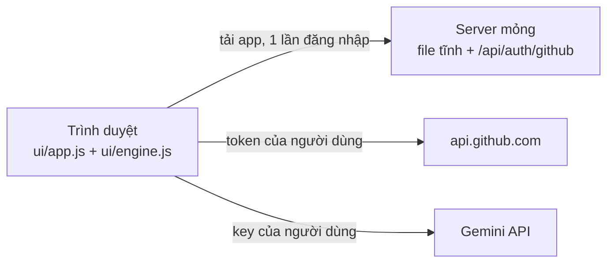

# Huddle60 trên GitHub: Tài liệu kỹ thuật triển khai

| Thuộc tính | Nội dung |
|---|---|
| Tài liệu | Đặc tả kỹ thuật tham chiếu |
| Mục đích | Mô tả chính xác kiến trúc, cấu trúc dữ liệu, giao thức và các thành phần đã triển khai trong mã nguồn Huddle60 |
| Trạng thái | Reference implementation hoàn chỉnh trong `src/` (xem [README.md](../README.md)). Kiến trúc zero-infra: **Local App (`huddle60 ui`) + GitHub Actions gate (`action.yml`)** |
| Đối tượng | Developer, maintainer, người cấu hình GitHub Organization và repository dự án |

---

## 1. Tổng quan kiến trúc & Phạm vi triển khai

### 1.1 Mô hình Zero-Infrastructure

Huddle60 được thiết kế và triển khai theo mô hình **zero-infra**, không đòi hỏi máy chủ lưu trữ, cơ sở dữ liệu tập trung bên ngoài hay hàng đợi tin nhắn:

- **Local App (`huddle60 ui`)**: Tiến trình chạy cục bộ trên máy trạm của PO và DEV tại `127.0.0.1`. Đảm nhiệm tương tác với Gemini API để phân rã yêu cầu tự nhiên thành cây Issues, tạo Issues trên GitHub và cung cấp giao diện trực quan cho các thao tác phê duyệt.
- **GitHub Actions (`action.yml`)**: Workflow chạy trên GitHub infrastructure với quyền hạn tối thiểu. Đảm nhiệm việc xác thực lệnh (baseline, approve, ready, accept, revoke), ghi nhận evidence vào Git branch và kiểm tra PR baseline gate (`huddle60/baseline`) bằng logic xác định (deterministic).
- **Git Branch (`huddle60-evidence`)**: Đóng vai trò là tamper-evident audit store. Lưu trữ toàn bộ snapshot baseline, decision receipts và revocation records dưới dạng JSON canonical (RFC 8785).
- **GitHub Issues & Projects v2**: Là nguồn chân lý (source of truth) duy nhất cho backlog, trạng thái công việc và thảo luận nghiệp vụ.

### 1.2 Các thành phần triển khai thực tế

| Thành phần | Đường dẫn mã nguồn | Mô tả chức năng |
|---|---|---|
| **Core Logic** | `src/core/` | Canonical RFC 8785, SHA-256 hash, parse policy, parse command, parse issue form, parse PR block, baseline snapshot, decision receipt, render phản hồi Markdown, từ điển `vocabulary.ts` và danh mục mã lỗi `errors.ts`. |
| **Local App Server** | `src/app/` | HTTP server Node.js chạy tại `127.0.0.1`, quản lý session token, kiểm tra CSRF/Host/Origin, cung cấp REST API cho giao diện người dùng. |
| **Local UI** | `ui/` | Giao diện Single Page Application (HTML/CSS/JS thuần không cần build), tương tác trực tiếp với Local App Server. |
| **Planner Engine** | `src/planner/` | Tích hợp `@google/genai`, prompt kỹ thuật và schema cho Gemini; `explorer.ts` đọc repo (bản đồ, manifest, scout chọn file liên quan); `knowledge.ts` sinh gói tri thức `.huddle60/knowledge.md`; `IssueTreeCreator` hỗ trợ tạo cây Issues cha-con (hỗ trợ native sub-issues và Projects v2) kèm cơ chế tracking node ledger. |
| **Workflow Service** | `src/workflow/` | Điều phối snapshot, kiểm tra chữ ký/hash, xác thực quyết định, xử lý status check PR (`huddle60/baseline`) và sinh context cho coding agent (`context.ts`). |
| **Adapters** | `src/adapters/` | Kết nối GitHub API (Octokit tự động retry/throttle), Git Data API evidence branch (`git-evidence.ts`), Gemini API (`gemini.ts`), và in-memory adapter (`memory.ts`) cho test. |
| **CLI & Action Entrypoints** | `src/entry/` | `cli.ts` (các lệnh `ui`, `init`, `context`, `init-evidence`, `validate-policy`, `plan-preview`, `knowledge`) và `action.ts` (GitHub Action runner cho issue comment và pull request). |
| **Templates** | `templates/` | Bộ template chuẩn bị sẵn để tích hợp vào repository mục tiêu (`policy.yml`, `huddle60.yml`, Issue forms, PR template, `AGENTS.md`). |

### 1.3 Ranh giới an ninh & Nguyên tắc hoạt động

1. **Không gọi AI model trong GitHub Actions**: GitHub Actions chỉ thực thi mã nguồn kiểm tra xác định (deterministic), không có secret gọi model, không chịu rủi ro về prompt injection trong môi trường CI.
2. **Quyền hạn dựa trên Numeric User ID**: Danh tính PO và DEV được xác thực bằng GitHub numeric user ID cố định trong policy file, không dựa trên display name hay login handle.
3. **Mọi quyết định đều có chữ ký nội dung**: Quyết định duyệt (`approve`), sẵn sàng (`ready`), nghiệm thu (`accept`) bắt buộc gắn liền với mã hash chuẩn hóa của nội dung Issue tại thời điểm quyết định. Bất kỳ sự thay đổi nào của Issue sau đó đều làm mất hiệu lực quyết định.
4. **Git Branch làm kho lưu trữ bằng chứng**: Toàn bộ dữ liệu snapshot và receipt được ghi vào branch `huddle60-evidence` thông qua Git Data API. Branch này được bảo vệ bằng GitHub Ruleset để ngăn chặn ghi đè hoặc chỉnh sửa lịch sử commit.

### 1.4 Triết lý AI Engineering: Lát cắt dọc kiểm thử được (Vertical Testable Slices)

Trong kỷ nguyên phát triển phần mềm có AI Coding Agents (Cursor, Claude Code, Copilot, Devin, SWE-bench agents):

- **Phê phán mô hình Agile/Scrum truyền thống:** Cách phân rã ticket theo tầng công nghệ (Horizontal Slices: Task UI, Task Backend API, Task Database migration) ra đời nhằm phục vụ việc chia việc cho những con người có kỹ năng chuyên môn riêng biệt. Trong môi trường AI, cách chia này gây ra **phân mảnh ngữ cảnh (context fragmentation)**: Agent làm UI phải mock dữ liệu giả, Agent làm API không biết UI render thế nào, và không một PR nào có thể kiểm thử độc lập được.
- **Mô hình Spec-Driven & Vertical Slices của Huddle60:**
  - AI Coding Agents là **Fullstack-by-default**: Một Agent có thể sửa đổi DB, backend API, giao diện UI và viết bộ test tự động chỉ trong một PR duy nhất.
  - Mỗi đơn vị công việc trong Huddle60 được thiết kế như một **lát cắt dọc hoàn chỉnh** có thể nghiệm thu độc lập (End-to-End Testable Capability).
  - **Acceptance Criteria (Given / When / Then)** đóng vai trò là đặc tả hành vi (Behavior Specification).
  - Agent khi nhận context từ Huddle60 (`huddle60 context --issue <n>`) bắt buộc phải hiện thực hóa kèm theo **bài kiểm thử tự động (Unit / Integration / E2E test)** chứng minh toàn bộ các tiêu chí AC đã vượt qua trước khi PR được chấp nhận qua gate `huddle60/baseline`.

---

## 2. Cấu trúc repository

### 2.1 Cấu trúc mã nguồn dự án Huddle60

```text
huddle60/
├── action.yml                  # Metadata khai báo GitHub Action
├── package.json                # Cấu hình dependency, scripts và metadata package npm
├── tsconfig.json               # Cấu hình TypeScript strict mode (ES2022, Node16 module)
├── scripts/
│   └── build.mjs               # Script build esbuild đóng gói dist/action.js và dist/cli.js
├── dist/                       # Mã bundle sản phẩm sau khi build
│   ├── action.js
│   └── cli.js
├── src/
│   ├── core/                   # Logic nền tảng không phụ thuộc I/O
│   │   ├── canonical.ts        # Canonical hóa JSON theo RFC 8785 & SHA-256
│   │   ├── policy.ts           # Schema validation và nạp file policy.yml
│   │   ├── command.ts          # Bộ phân tích cú pháp lệnh /huddle60
│   │   ├── issue-form.ts       # Phân tích cú pháp Markdown Issue form (Epic, Story, Task, Request)
│   │   ├── plan.ts             # Schema và kiểu dữ liệu cây kế hoạch phân rã
│   │   ├── baseline.ts         # Khởi tạo snapshot và tính toán baseline hash
│   │   ├── decision.ts         # Khởi tạo và kiểm tra tính hợp lệ của receipt
│   │   ├── pr-block.ts         # Đọc và ghi khối metadata Huddle60 trong PR body
│   │   ├── render.ts           # Định dạng Markdown cho comment phản hồi
│   │   ├── vocabulary.ts       # Hằng số nhãn, lệnh, tên status check và marker
│   │   └── errors.ts           # Định nghĩa mã lỗi chuẩn E_*
│   ├── app/                    # Local App chạy trên máy cá nhân
│   │   ├── app.ts              # LocalApp facade (quản lý plans, items, decisions)
│   │   ├── server.ts           # HTTP server Node.js với cơ chế bảo vệ local
│   │   └── start.ts            # Quản lý credentials, mở trình duyệt và chạy app
│   ├── planner/                # Mô đun lập kế hoạch
│   │   ├── prompt.ts           # System prompt và instructions cho Gemini
│   │   ├── generate.ts         # Gọi Gemini API với structured JSON schema
│   │   └── creator.ts          # IssueTreeCreator: tạo Issues tuần tự, ghi marker tracking
│   ├── workflow/               # Quy trình nghiệp vụ
│   │   ├── service.ts          # WorkflowService: xử lý lệnh comment và kiểm tra PR gate
│   │   └── context.ts          # Trích xuất ngữ cảnh baseline cho coding agent trong IDE
│   ├── adapters/               # Các kết nối ngoại vi
│   │   ├── github.ts           # Octokit client với retry và rate-limit handling
│   │   ├── git-evidence.ts     # Adapter đọc/ghi branch evidence qua Git Data API
│   │   ├── gemini.ts           # Adapter gọi @google/genai
│   │   └── memory.ts           # In-memory store phục vụ testing
│   └── entry/                  # Điểm khởi chạy ứng dụng
│       ├── cli.ts              # Entrypoint cho CLI command `huddle60`
│       └── action.ts           # Entrypoint cho GitHub Action runner
├── ui/                         # Giao diện tĩnh của Local App (HTML, CSS, JS)
│   ├── index.html
│   ├── styles.css
│   └── app.js
├── templates/                  # Thư mục mẫu phân phối tới dự án áp dụng
│   ├── .github/
│   │   ├── huddle60/
│   │   │   └── policy.yml
│   │   ├── workflows/
│   │   │   └── huddle60.yml
│   │   ├── ISSUE_TEMPLATE/
│   │   │   ├── config.yml
│   │   │   ├── epic.yml
│   │   │   ├── request.yml
│   │   │   ├── story.yml
│   │   │   └── task.yml
│   │   └── PULL_REQUEST_TEMPLATE.md
│   └── AGENTS.md
└── tests/                      # Bộ kiểm thử unit và kịch bản end-to-end
```

### 2.2 Template cấu hình trong repository người dùng

Khi chạy lệnh `npx huddle60 init`, hệ thống sao chép các tệp sau vào dự án của người dùng:

- `.github/huddle60/policy.yml`: File cấu hình vai trò, rủi ro, dự án và branch evidence.
- `.github/workflows/huddle60.yml`: GitHub Actions workflow lắng nghe sự kiện `issue_comment` và `pull_request` / `pull_request_target`.
- `.github/ISSUE_TEMPLATE/`: Các form mẫu định dạng YAML cho `request.yml`, `epic.yml`, `story.yml`, `task.yml` và `config.yml`.
- `.github/PULL_REQUEST_TEMPLATE.md`: Khung mẫu PR tích hợp khối tracking Huddle60.
- `AGENTS.md`: Chỉ dẫn tiêu chuẩn cho các AI coding agent trong IDE.

---

## 3. Cấu hình GitHub

### 3.1 Nhãn (Labels)

Huddle60 sử dụng hệ thống nhãn có tiền tố `huddle60:`:

| Nhãn | Mục đích |
|---|---|
| `huddle60:request` | Đánh dấu Issue nhập yêu cầu tự nhiên ban đầu của PO. |
| `huddle60:plan-draft` | Đánh dấu yêu cầu đã có bản kế hoạch phân rã nháp do AI sinh ra. |
| `huddle60:plan-created` | Đánh dấu cây Issues đã được tạo đầy đủ trên GitHub. |
| `huddle60:plan-partial` | Đánh dấu quá trình tạo cây Issues bị gián đoạn, cần resume tiếp tục. |
| `huddle60:stale` | Gắn vào Issue khi nội dung bị sửa sau thời điểm phê duyệt baseline. |
| `type:epic`, `type:story`, `type:task` | Phân loại phân cấp công việc. |
| `lane:fast`, `lane:standard`, `lane:strict` | Phân loại luồng triển khai theo mức độ rủi ro (tùy chọn hiển thị). |

> [!NOTE]
> Nhãn chỉ dùng để hiển thị trực quan và lọc danh sách trên giao diện GitHub. Mọi quyết định xác thực và kiểm soát quyền hạn (gate) hoàn toàn dựa trên dữ liệu cryptographic receipt trong branch evidence, không tin cậy nhãn.

### 3.2 Cấu trúc Issue Forms

Parser trong `src/core/issue-form.ts` phân tích phần thân Issue dựa trên các tiêu đề Markdown cấp 3 (`### <Tên trường>`) do GitHub Issue Form sinh ra.

#### Form Story (`.github/ISSUE_TEMPLATE/story.yml`)
- `Mục tiêu và người dùng` (`goal`): Mô tả giá trị mang lại cho người dùng.
- `Phạm vi` (`scope`): Định rõ việc trong phạm vi, ngoài phạm vi và business rules.
- `Issue cha` (`parent`): Số Issue của Epic cha (ví dụ: `#10`).
- `Blocked by` (`blocked_by`): Danh sách các Issue tiền đề cần hoàn thành trước (ví dụ: `#5, #8`).
- `Acceptance Criteria` (`acceptance_criteria`): Mỗi dòng là một tiêu chí nghiệm thu hợp lệ theo định dạng `- AC-xx: Given ... When ... Then ...`.
- `Tham chiếu kỹ thuật` (`technical_refs`): Đường dẫn tài liệu, commit hoặc tài nguyên kỹ thuật liên quan.
- `Câu hỏi và rủi ro` (`risks`): Ghi nhận rủi ro tiềm ẩn.

#### Form Request (`.github/ISSUE_TEMPLATE/request.yml`)
Là nơi PO nhập yêu cầu bằng ngôn ngữ tự nhiên:
```yaml
name: Huddle60 Request
description: Nhập yêu cầu bằng ngôn ngữ tự nhiên để AI phân rã thành cây công việc
title: "[Request] "
labels: ["huddle60:request"]
body:
  - type: textarea
    id: request
    attributes:
      label: Yêu cầu
      description: Mô tả kết quả mong muốn bằng ngôn ngữ tự nhiên
      placeholder: "Xây dựng tính năng đăng nhập Google OAuth"
    validations:
      required: true
```

### 3.3 GitHub Projects v2

Khi cấu hình trường `project` trong policy file, hệ thống sẽ tự động thêm Issue vào Organization Project v2 và đồng bộ trạng thái:
- `Status`: Khởi tạo tại Backlog/Refinement, chuyển sang `Ready` khi DEV sẵn sàng, và chuyển `Done` khi PO nghiệm thu hoàn tất.
- `Lane`: Ghi nhận luồng rủi ro (`Fast`, `Standard`, `Strict`).

### 3.4 Quy tắc bảo vệ Branch (Rulesets)

1. **Branch mặc định (`main` / `master`)**:
   - Yêu cầu Pull Request trước khi merge.
   - Bắt buộc kiểm tra status check: `huddle60/baseline`.
   - Yêu cầu review từ CODEOWNERS đối với `.github/`, `src/`, `AGENTS.md`.
   - Chặn force push và cấm xóa branch.
2. **Branch evidence (`huddle60-evidence`)**:
   - Tạo dưới dạng orphan branch ban đầu.
   - Chặn force push và cấm xóa branch.
   - Chỉ cho phép ghi thông qua GitHub Actions bot hoặc installation token hợp lệ.

---

## 4. Policy File

File policy được đọc trực tiếp từ branch mặc định: `.github/huddle60/policy.yml`.

```yaml
version: 1
roles:
  po:
    - id: 1000001
      login: po-user
  dev:
    - id: 1000002
      login: dev-user
project:
  owner: your-org
  number: 1
  fields:
    status: Status
    lane: Lane
  status_options:
    ready: Ready
    in_progress: In Progress
    technical_review: Technical Review
    acceptance: Acceptance
    done: Done
lanes:
  fast:
    requires_po_approval: false
  standard:
    requires_po_approval: true
  strict:
    requires_po_approval: true
    requires_reviewers: ["@your-org/tech-leads"]
sensitive_paths:
  - "migrations/**"
  - "src/auth/**"
  - ".github/**"
evidence:
  branch: huddle60-evidence
acceptance:
  build_workflows:
    - .github/workflows/build.yml
planner:
  max_nodes: 60
  plan_ttl_days: 30
  read_source: true        # Cho planner đọc source code liên quan trước khi lập kế hoạch
  max_source_files: 12     # Số file tối đa scout được chọn (0 = chỉ dùng bản đồ repo)
  source_deny: []          # Đường dẫn bổ sung không bao giờ gửi cho model
```

### Quy tắc xác thực Policy:
- **Định danh Role bằng User ID**: So sánh trực tiếp giá trị numeric `user.id` từ GitHub webhook/API. Giá trị `login` chỉ mang tính chất ghi chú đọc hiểu.
- **Phân tách vai trò**: Một người dùng có thể thuộc cả role `po` và `dev`. Tuyệt đối không đưa tài khoản Bot vào các role này.
- **Đường dẫn nhạy cảm (`sensitive_paths`)**: Mọi PR có chứa thay đổi trong các đường dẫn này sẽ bị từ chối chạy ở lane `fast`.
- **Đọc source khi lập kế hoạch (`planner.*`)**: `source_deny` chỉ mở rộng danh sách chặn mặc định (`.env*`, khóa, secrets), không thu hẹp được. Đặt `read_source: false` nếu tổ chức không cho phép gửi code tới nhà cung cấp model.
- **Validation**: Nếu file policy bị sai cú pháp hoặc vi phạm schema, toàn bộ các thao tác xử lý lệnh sẽ dừng lại với mã lỗi `E_POLICY_INVALID`.

---

## 5. Dữ liệu, Snapshot và Hash

### 5.1 Chuẩn hóa Canonical (RFC 8785) & Content Hash

Để đảm bảo tính xác định (deterministic) khi băm nội dung:
1. Chuẩn hóa chuỗi văn bản: Chuyển về dạng Unicode NFC, chuẩn hóa xuống dòng thành `\n`, loại bỏ khoảng trắng ở cuối mỗi dòng, loại bỏ các dòng trống dư thừa ở đầu và cuối nội dung.
2. Sắp xếp các khóa thuộc tính và serialize theo chuẩn **RFC 8785 (JSON Canonicalization Scheme - JCS)**.
3. Tính mã băm bằng thuật toán SHA-256, biểu diễn dưới dạng chuỗi `sha256:<hex>`.

> [!NOTE]
> Các thông tin meta của GitHub như trạng thái Project, assignees, labels, reactions và các bình luận trao đổi thông thường không nằm trong payload tính hash. Chỉ nội dung nghiệp vụ trong Issue form mới làm thay đổi mã hash.

### 5.2 Baseline Snapshot Model

Đường dẫn lưu trữ trên branch evidence: `baselines/<repoId>/<issueNumber>/<baselineId>.json`.
Cấu trúc `baselineId`: `bl-<issueNumber>-<12 ký tự hex đầu của contentHash>`.

```json
{
  "schemaVersion": 1,
  "canonicalVersion": 1,
  "baselineId": "bl-11-3f2a9c1d7e4b",
  "kind": "story",
  "source": {
    "repositoryId": 123456789,
    "issueNodeId": "I_kwDOexample",
    "issueNumber": 11
  },
  "requirements": {
    "title": "Người dùng đăng nhập bằng tài khoản Google",
    "sections": {
      "Mục tiêu và người dùng": "Cho phép người dùng đăng nhập bằng Google OAuth",
      "Phạm vi": "- Trong phạm vi: OAuth 2.0 flow\n- Ngoài phạm vi: Đăng ký thủ công",
      "Acceptance Criteria": "- AC-01: Given người dùng nhấn nút Đăng nhập bằng Google When hoàn tất xác thực Then tạo phiên làm việc hợp lệ",
      "Tham chiếu kỹ thuật": "docs/auth.md",
      "Câu hỏi và rủi ro": "Cần cấu hình OAuth Consent Screen"
    },
    "acceptanceCriteria": [
      {
        "id": "AC-01",
        "text": "Given người dùng nhấn nút Đăng nhập bằng Google When hoàn tất xác thực Then tạo phiên làm việc hợp lệ"
      }
    ]
  },
  "parent": 10,
  "blockedBy": [],
  "contractRefs": [],
  "contentHash": "sha256:3f2a9c1d7e4b0000000000000000000000000000000000000000000000000000"
}
```

### 5.3 Decision Receipt Model

Đường dẫn lưu trữ: `decisions/<repoId>/<issueNumber>/<decisionId>.json`.
Cấu trúc `decisionId`: `dec-` + 16 ký tự hex đầu của mã SHA-256 tính từ chuỗi `<kind>:<commentId>`.

```json
{
  "schemaVersion": 1,
  "decisionId": "dec-9a8b7c6d5e4f3a2b",
  "kind": "approve",
  "baselineId": "bl-11-3f2a9c1d7e4b",
  "baselineHash": "sha256:3f2a9c1d7e4b0000000000000000000000000000000000000000000000000000",
  "actor": {
    "id": 1000001,
    "login": "po-user",
    "role": "po"
  },
  "source": {
    "commentId": 2000001,
    "commentBodyDigest": "sha256:1111111111111111111111111111111111111111111111111111111111111111"
  },
  "lane": null,
  "build": null,
  "policyCommitSha": "2222222222222222222222222222222222222222",
  "toolVersion": "0.1.0",
  "recordedAt": "2026-10-29T10:00:00Z"
}
```

### 5.4 Revocation Model

Đường dẫn lưu trữ: `revocations/<repoId>/<issueNumber>/<decisionId>.json`.
Chứa thông tin thu hồi quyết định đã ban hành, actor thực hiện và lý do thu hồi.

### 5.5 Kiểm tra hiệu lực động của Receipt

Receipt không lưu cờ trạng thái tĩnh. Khi có yêu cầu kiểm tra, hệ thống tính toán hiệu lực động theo các điều kiện:
1. File receipt tồn tại và tuân thủ JSON schema.
2. Chưa có bản ghi revocation tương ứng với `decisionId`.
3. Comment tạo ra quyết định vẫn còn tồn tại trên GitHub Issue và digest nội dung comment không bị thay đổi.
4. Actor thực hiện vẫn có vai trò tương ứng trong policy hiện hành trên branch mặc định.
5. Snapshot baseline tương ứng tồn tại và hash nội dung Issue hiện tại khớp hoàn toàn với `baselineHash` ghi trong receipt.
6. Đối với lệnh `accept`: Workflow run nghiệm thu tồn tại, hoàn thành với trạng thái `success` trên branch mặc định.

---

## 6. Command Handler (Xử lý lệnh)

### 6.1 Cú pháp lệnh

Lệnh được kích hoạt khi nằm ở **dòng đầu tiên** của một comment trên Issue (tiền tố `/huddle60`):

```text
/huddle60 baseline
/huddle60 approve baseline=<baselineId> hash=<contentHash>
/huddle60 ready baseline=<baselineId> hash=<contentHash> lane=<fast|standard|strict>
/huddle60 accept baseline=<baselineId> run=<runId> commit=<sha>
/huddle60 revoke decision=<decisionId> reason="<lý do thu hồi>"
```

Tham số truyền vào dưới dạng `key=value`. Giá trị có khoảng trắng bắt buộc bọc trong dấu nháy kép `""`. Comment từ tài khoản Bot, comment bị chỉnh sửa sau khi gửi hoặc comment trích dẫn trong code block đều bị bỏ qua.

### 6.2 Bảng phân quyền lệnh theo Role

| Lệnh | Role thực thi | Điều kiện tiền đề |
|---|---|---|
| `baseline` | `po` hoặc `dev` | Issue hợp lệ (`type:epic`, `type:story`, `type:task`), form phân tích cú pháp thành công. |
| `approve` | `po` | Hash khớp nội dung Issue hiện tại. Tự động lưu snapshot baseline nếu chưa có. |
| `ready` | `dev` | Hash khớp nội dung Issue hiện tại. Lane hợp lệ theo policy; nếu lane yêu cầu PO approval thì Story phải có `approve` hợp lệ; mọi Issue trong `blockedBy` phải đã đóng. |
| `accept` | `po` | Chỉ áp dụng cho Epic hoặc Story. Bắt buộc đã có `ready` hợp lệ cho baseline này; workflow run tương ứng phải pass trên branch mặc định. |
| `revoke` | Người tạo decision, hoặc `po` (cho approve/accept), `dev` (cho ready) | Quyết định tồn tại và chưa bị thu hồi trước đó. |

### 6.3 Quy trình xử lý lệnh xác định trong GitHub Action

Khi workflow GitHub Action nhận sự kiện `issue_comment`:
1. Bỏ qua nếu comment thuộc về Pull Request hoặc người gửi là Bot.
2. Kiểm tra dòng đầu tiên xem có khớp tiền tố `/huddle60` hay không.
3. Tải nội dung file policy từ branch mặc định và xác thực schema.
4. Phân tích cú pháp lệnh và trích xuất danh sách tham số.
5. Kiểm tra quyền hạn của người gửi dựa trên numeric user ID theo policy.
6. Truy vấn lại nội dung hiện tại của Issue qua GitHub REST API để đảm bảo tính thời gian thực.
7. Thực thi kiểm tra nghiệp vụ tương ứng (mục 6.2).
8. Ghi dữ liệu vào branch evidence qua Git Data API.
9. Cập nhật nhãn và trường Status trong GitHub Projects v2 (nếu có cấu hình).
10. Đăng comment phản hồi trên Issue kèm marker ẩn `<!-- huddle60:reply:<commentId> -->`.

### 6.4 Điều kiện nghiệm thu Build khi PO Accept

Khi thực hiện lệnh `accept`, hệ thống kiểm tra thông tin workflow run qua GitHub API (`GET /repos/{owner}/{repo}/actions/runs/{runId}`):
- Run thuộc về chính repository này.
- Đường dẫn file workflow nằm trong danh sách `acceptance.build_workflows` cấu hình tại policy.
- Sự kiện kích hoạt (`event`) là `push` vào branch mặc định.
- Commit SHA trùng khớp với tham số `commit` trong lệnh.
- Trạng thái hoàn thành: `status == "completed"` và kết quả `conclusion == "success"`.

### 6.5 Bảng mã lỗi tiêu chuẩn

| Mã lỗi | Giải thích |
|---|---|
| `E_POLICY_INVALID` | File policy không hợp lệ hoặc không thể phân tích cú pháp |
| `E_SYNTAX` | Cú pháp câu lệnh không hợp lệ hoặc thiếu tham số bắt buộc |
| `E_ROLE` | Người thực hiện không có vai trò phù hợp trong policy |
| `E_FORM` | Không phân tích được cấu trúc form của Issue hoặc thiếu AC |
| `E_HASH_MISMATCH` | Mã hash trong lệnh không khớp với mã hash tính từ nội dung Issue hiện tại |
| `E_BASELINE_NOT_FOUND` | Không tìm thấy baseline snapshot tương ứng với ID cung cấp |
| `E_NOT_APPROVED` | Lane yêu cầu sự phê duyệt của PO nhưng chưa có receipt `approve` hợp lệ |
| `E_NOT_READY` | Issue chưa có receipt `ready` hợp lệ từ DEV |
| `E_DEPENDENCY_OPEN` | Còn Issue trong danh sách phụ thuộc (`blockedBy`) chưa hoàn thành |
| `E_BUILD_INVALID` | Workflow run không thỏa mãn các điều kiện kiểm tra nghiệm thu |
| `E_CONFLICT` | Đã tồn tại bản ghi bằng chứng khác cho cùng một ID |
| `E_GITHUB_API` | Lỗi phát sinh trong quá trình gọi GitHub API sau khi đã thử lại |
| `E_PLAN_SCHEMA` | Kế hoạch phân rã từ AI không khớp với schema quy định |
| `E_WRONG_KIND` | Lệnh không áp dụng được cho loại Issue này (ví dụ: gọi `accept` trên Task) |
| `E_CONFIG` | Local App thiếu cấu hình cần thiết (`GITHUB_TOKEN` hoặc `GEMINI_API_KEY`) |

---

## 7. Local App (`huddle60 ui`)

### 7.1 Cơ chế hoạt động & Xác thực Local

Local và SaaS dùng chung browser engine. Server chỉ phục vụ giao diện và đổi mã OAuth:

```bash
# Khởi chạy giao diện
npx huddle60 ui --repo owner/repo
```

- **Quản lý Credentials**:
  - Đăng nhập GitHub qua OAuth hoặc nhập PAT trong Cài đặt; Gemini key cũng nhập tại đây.
  - UI không đọc `gh`, Keychain, biến môi trường chứa credential hay file cấu hình cũ. Không tự chuyển bí mật từ máy vào trình duyệt. Các lệnh CLI ngoài `ui` giữ cách xác thực cũ.
  - Mặc định token/key ở `sessionStorage`. Bật **Ghi nhớ trên thiết bị này** để chuyển sang `localStorage`; tab mới cùng origin sử dụng lại cả hai. Bỏ chọn xóa bản lưu lâu dài, giữ phiên của tab hiện tại.
  - Đăng xuất xóa cả hai loại lưu trữ và thông báo các tab cùng origin bỏ credential trong bộ nhớ. Thay đổi credential từ tab khác làm mới phiên và bỏ draft kế hoạch của tab đó.
  - Chỉ ghi nhớ trên thiết bị cá nhân: JavaScript cùng origin đọc được key. Subdomain khác nhau không chia sẻ credential.
  - OAuth localhost cần cấu hình `GITHUB_CLIENT_ID` / `GITHUB_CLIENT_SECRET` trên server và callback URL khớp địa chỉ thực tế. Không có OAuth thì dùng PAT.
- **Bảo mật Server Local**:
  - Mặc định bind `127.0.0.1`, kiểm tra `Host` và `Origin`.
  - Không còn session token hay Node data API; các route nghiệp vụ được dispatch trực tiếp trong browser engine.
  - Áp dụng Content Security Policy (CSP) chặt chẽ, vô hiệu hóa inline scripts và ngăn chặn embedding iframe.

### 7.2 Lập kế hoạch với Gemini (`@google/genai`)

1. PO nhập tiêu đề và yêu cầu bài toán bằng ngôn ngữ tự nhiên trên giao diện.
2. Local App đọc source code trước khi lập kế hoạch (mục 7.2.1).
3. Browser engine gọi Gemini API bằng structured output với model chọn trong Cài đặt.
4. Model trả về danh sách có cấu trúc bao gồm các Epic, Story và Task kèm theo tiêu chí nghiệm thu (AC) chuẩn hóa, bản đồ tác động và câu trả lời đề xuất cho các câu hỏi mở.
5. PO có thể cung cấp thêm thông tin làm rõ (refinement) hoặc bấm **Dùng đề xuất của AI** để sinh bản sửa đổi mới (`revision`) trước khi đồng ý tạo.

#### 7.2.1 Đọc source code trước khi lập kế hoạch (`src/planner/explorer.ts`)

Planner đọc repository theo cách một kỹ sư làm trước khi ước lượng, gồm hai lượt gọi model:

| Bước | Nội dung | Giới hạn |
|---|---|---|
| 1. Bản đồ repo | Cây file của nhánh mặc định (Git Trees API), bỏ `node_modules/`, `dist/`, file nhị phân; sắp xếp file nông trước và đếm số file theo thư mục cấp 1 | 600 đường dẫn, cache 5 phút |
| 2. Tổng quan | Manifest của nhiều hệ sinh thái (`package.json`, `pyproject.toml`, `go.mod`, `pom.xml`, `Package.swift`, `pubspec.yaml`...), `README.md` và gói tri thức `.huddle60/knowledge.md` | 3.000 ký tự mỗi manifest, 20.000 ký tự cho gói tri thức |
| 3. Scout | Model chọn các file liên quan nhất tới yêu cầu (entry point, route, model, schema, service, test gần nhất) | `planner.max_source_files` (mặc định 12) |
| 4. Đọc file | Chỉ đọc file có trong bản đồ, không bị chặn, dưới 200 KB | 12.000 ký tự mỗi file, 80.000 ký tự tổng |
| 5. Lập kế hoạch | Prompt chứa `<repository_overview>`, `<project_knowledge>`, `<repo_map>`, `<source_files>` | Prompt `planner-v5` |

Nguyên tắc:

- **Không chặn:** scout lỗi hoặc trả JSON sai thì vẫn lập kế hoạch với bản đồ repo. Không liệt kê được file thì quay về ngữ cảnh nông như trước.
- **Đọc một lần cho mỗi bản nháp:** các lần refine dùng lại kết quả đã đọc, không tốn thêm lượt scout.
- **Không bao giờ gửi bí mật cho model:** `.env*`, `*.pem`, `*.key`, `*.p12`, `*.keystore`, `id_rsa*`, `**/secrets/**`, file có `secret` hoặc `credential` trong tên, `*.tfstate` luôn bị loại, kể cả khi scout yêu cầu. Mở rộng bằng `planner.source_deny`.
- **Nội dung repo là dữ liệu không đáng tin:** được bọc trong thẻ riêng và system prompt yêu cầu bỏ qua mọi chỉ thị bên trong (chống prompt injection qua comment hoặc README).
- **Tắt được:** `planner.read_source: false` để không gửi nội dung code cho model.

#### 7.2.2 Gói tri thức repo (`.huddle60/knowledge.md`)

- Sinh bằng `npx huddle60 knowledge`: đọc repo (tối thiểu 20 file), tóm tắt kiến trúc, module, thuật ngữ nghiệp vụ, quy ước, cách chạy test và vùng nhạy cảm. File được ghi cục bộ; DEV review và commit qua PR.
- Khi sinh lại, nội dung cũ được đưa vào prompt để giữ các ghi chú do người viết, trừ khi code mâu thuẫn.
- Planner, scout và `huddle60 context` đều dùng file này, nên kế hoạch nhanh và rẻ hơn, coding agent biết quy ước dự án.

#### 7.2.3 Bản đồ tác động (Impact Map)

- Mỗi Story hoặc Task có trường `impact`: `files` (file dự kiến thay đổi), `reuse` (thành phần tái sử dụng), `tests` (test cần mở rộng hoặc thêm) và `confidence` (`low` / `medium` / `high`).
- Đường dẫn không có trong repo được đánh dấu `(mới)`, giúp DEV phân biệt file sẽ tạo với file model đoán sai.
- Ghi vào Issue dưới mục `### Bản đồ tác động (AI gợi ý)`. Mục này **không nằm trong `REQUIREMENT_SECTIONS`**, nên sửa nó không làm baseline bị stale và không cần PO duyệt lại.
- `huddle60 context` đưa bản đồ này vào ngữ cảnh cho agent dưới dạng gợi ý, không giới hạn phạm vi.

#### 7.2.4 Câu trả lời đề xuất (Suggested Answers)

- Mỗi câu hỏi mở có thể kèm `suggestedAnswer` và `evidence` (ví dụ `src/auth/session.ts: SESSION_TTL_MINUTES = 30`). Model chỉ đề xuất khi có căn cứ từ code, gói tri thức hoặc tài liệu đính kèm.
- Câu hỏi có đề xuất đủ căn cứ thường được đánh dấu không chặn.
- PO bấm **Dùng N đề xuất của AI** (`POST /api/plans/:id/accept-suggestions`): mọi đề xuất được ghi thành một clarification và kế hoạch được sinh lại, không phải gõ tay.

### 7.3 Tạo cây Issues tự động (`IssueTreeCreator`)

Khi PO xác nhận tạo cây Issues:
1. `IssueTreeCreator` kiểm tra xem người dùng hiện tại có vai trò `po` trong policy hay không.
2. Tạo một Issue yêu cầu gốc với nhãn `huddle60:request`.
3. Tạo tuần tự từng Issue con theo thứ tự: Epic → Story → Task.
4. Mỗi Issue được gắn marker ẩn chứa thông tin phân cấp:
   `<!-- huddle60:plan-node planId=<id> localId=<nodeId> parentLocalId=<parentId> -->`
5. Tự động thiết lập quan hệ cha-con thông qua GitHub Sub-issues API (nếu repository đã bật tính năng này) hoặc cập nhật vào GitHub Projects v2.
6. Cơ chế ledger ghi nhớ tiến độ tạo: nếu quá trình bị gián đoạn giữa chừng, PO có thể tiếp tục tạo lại mà không bị trùng lặp Issue.

### 7.4 Routes nội bộ của browser engine (Local và SaaS)

Các tuyến `/api/*` bên dưới là lời gọi nội bộ trong trình duyệt, không phải HTTP API của server.

| Phương thức | Tuyến đường | Mục đích |
|---|---|---|
| `GET` | `/api/session` | Lấy thông tin repository, người dùng hiện tại, role theo policy, trạng thái Gemini và default lane |
| `POST` | `/api/plans` | Soạn thảo kế hoạch phân rã từ `{ title?, request }` |
| `POST` | `/api/plans/:id/refine` | Yêu cầu tinh chỉnh lại kế hoạch với thông tin bổ sung `{ clarification }` |
| `POST` | `/api/plans/:id/accept-suggestions` | Chấp nhận mọi câu trả lời AI đề xuất và sinh lại kế hoạch |
| `POST` | `/api/plans/:id/create` | Bắt đầu tạo Request Issue và cây Issues tương ứng trên GitHub |
| `GET` | `/api/items` | Truy vấn danh sách các Issue đang mở kèm trạng thái stage và cờ cảnh báo sửa đổi |
| `POST` | `/api/issues/:n/decisions` | Thực hiện đăng comment lệnh `/huddle60 approve`, `ready`, hoặc `accept` bằng token của người dùng |
| `GET` | `/api/issues/:n/replies/:commentId` | Tra cứu phản hồi từ bot GitHub Action tương ứng với comment lệnh đã gửi |
| `GET` | `/api/builds` | Lấy danh sách các bản build thành công trên branch mặc định để PO chọn nghiệm thu |
| `GET` | `/api/issues/:n/context` | Trích xuất toàn bộ ngữ cảnh baseline của Issue phục vụ coding agent trong IDE |

### 7.5 Server mỏng dùng chung Local và SaaS (ví dụ huddle60.app)

Ở cả Local và SaaS, **ứng dụng chạy trong trình duyệt của từng người**. Server chỉ phục vụ file tĩnh và đổi OAuth code lấy token. Server không lưu token; chỉ xử lý token tạm thời trong bước OAuth exchange, không proxy API nghiệp vụ GitHub/Gemini. `HUDDLE60_MODE=saas` không còn cần thiết.



| Thành phần | Vị trí | Ghi chú |
|---|---|---|
| Engine (`src/web/engine.ts` → `ui/engine.js`) | Trình duyệt | Local và SaaS đều nạp engine; dùng `LocalAppManager` ở chế độ `ephemeral`, `LocalApp`, planner, workflow và bảng route `src/app/routes.ts` |
| Token GitHub, Gemini key | `sessionStorage` mặc định; `localStorage` khi chọn ghi nhớ | Chỉ lưu trong trình duyệt, cùng origin; server chỉ thấy GitHub token trong bước OAuth exchange, không lưu lại |
| Repo đang chọn, model, repo gần đây | `localStorage` | Không chứa bí mật |
| Bản nháp kế hoạch, tệp đính kèm | Bộ nhớ của tab | Không đi qua server |
| OAuth | Server | `state` lưu trong cookie `huddle60_oauth` (`HttpOnly`, `Path=/api/auth`, 10 phút) và được so khớp khi callback. Token trả về qua URL fragment `#gh_token=…`; UI đọc rồi xóa ngay khỏi thanh địa chỉ. `returnUrl` chỉ nhận đường dẫn tương đối |
| `/api/*` khác | Server | Trả `404 E_BROWSER_MODE`. Server không có API dữ liệu |
| Thao tác ghi | Engine | Trả `401 E_AUTH` nếu người dùng chưa đăng nhập GitHub. Comment quyết định được đăng bằng token của chính họ |
| CSP | Server | `connect-src` chỉ mở thêm `api.github.com`, `uploads.github.com`, `generativelanguage.googleapis.com`, `models.github.ai`. Không cho inline script |

Băm SHA-256 dùng bản cài đặt thuần TypeScript (`src/core/sha256.ts`), cho cùng kết quả trên Node và trình duyệt. Kết quả trùng từng byte với `node:crypto`, nên baseline và evidence cũ vẫn hợp lệ.

Khi deploy public: cấu hình `ALLOWED_HOSTS=huddle60.app`; thêm `GITHUB_CLIENT_ID`, `GITHUB_CLIENT_SECRET` nếu dùng OAuth. Build bằng `npm run build` để sinh `ui/engine.js`.

> [!NOTE]
> Tải trên server chỉ còn file tĩnh (đặt sau CDN) và 1 request mỗi lần đăng nhập. Hạn mức GitHub tính theo từng người dùng (5.000 request/giờ). Khách chưa đăng nhập dùng hạn mức không token **theo IP của chính họ** (60 request/giờ). Đánh đổi: token nằm trong trình duyệt nên phải giữ CSP chặt và chỉ gán nội dung bằng `textContent`.

---

## 8. Evidence Store (`huddle60-evidence`)

### 8.1 Cấu trúc lưu trữ trên Git Branch

Toàn bộ chứng cứ của quy trình được lưu trữ trên một orphan branch riêng biệt (`huddle60-evidence`):

```text
baselines/
  └── <repoId>/
      └── <issueNumber>/
          └── bl-<issueNumber>-<hash>.json     # Snapshot baseline
decisions/
  └── <repoId>/
      └── <issueNumber>/
          └── dec-<hash>.json                  # Biên nhận approve, ready, accept
revocations/
  └── <repoId>/
      └── <issueNumber>/
          └── dec-<hash>.json                  # Bản ghi thu hồi quyết định
```

### 8.2 Cơ chế đọc/ghi qua Git Data API

Việc lưu trữ bằng chứng được thực hiện trực tiếp thông qua Git Data API của GitHub mà không cần clone repository:
1. Đọc commit SHA và tree SHA hiện tại của branch evidence.
2. Kiểm tra đường dẫn tệp cần ghi: nếu tệp đã tồn tại với nội dung giống hệt, ghi nhận thành công (idempotent); nếu nội dung khác biệt, báo lỗi `E_CONFLICT`.
3. Tạo Git blob mới chứa nội dung JSON canonical.
4. Tạo Git tree mới kế thừa từ tree hiện tại.
5. Tạo Git commit mới với message mô tả hành động (ví dụ: `huddle60: approve dec-1234 (issue #11)`).
6. Cập nhật Git reference của branch với `force: false`.
7. Trong trường hợp xảy ra xung đột cập nhật tham chiếu do các thao tác đồng thời, hệ thống tự động thử lại tối đa 5 lần với cơ chế exponential backoff (0.5s, 1s, 2s, 4s, 8s).

---

## 9. PR Quality Gate (`huddle60/baseline`)

### 9.1 Khối Huddle60 trong PR Body

Mọi Pull Request triển khai mã nguồn cho một Issue bắt buộc phải chứa khối khai báo Huddle60 trong phần mô tả (PR body):

```text
<!-- huddle60:begin -->
Huddle60-Issue: #11
Huddle60-Baseline: bl-11-3f2a9c1d7e4b
Huddle60-Hash: sha256:3f2a9c1d7e4b0000000000000000000000000000000000000000000000000000
Huddle60-AC: AC-01, AC-02
<!-- huddle60:end -->
```

> [!TIP]
> Khối này được tự động tạo ra bằng lệnh `npx huddle60 context --issue <số>` hoặc sao chép nhanh từ nút **Copy Context** trong giao diện `huddle60 ui`.

### 9.2 Quy trình xác thực Commit Status Check

Khi PR được mở hoặc cập nhật (`opened`, `edited`, `synchronize`, `reopened`, `ready_for_review`), workflow GitHub Action sẽ kích hoạt và ghi kết quả commit status với context `huddle60/baseline`.

Thứ tự các bước kiểm tra:
1. **Phân tích khối PR**: Trích xuất Issue ID, Baseline ID, Content Hash và danh sách AC khai báo.
2. **Kiểm tra loại Issue**: Issue phải thuộc repository hiện tại và có phân loại là Story hoặc Task.
3. **Kiểm tra Snapshot**: File baseline snapshot phải tồn tại trên branch evidence và mã hash tính lại phải khớp với `Huddle60-Hash`.
4. **Kiểm tra tính nguyên vẹn (Stale Check)**: Tính toán mã hash từ nội dung Issue hiện tại trên GitHub. Nếu nội dung Issue đã bị thay đổi so với baseline ban đầu, check thất bại ngay với lỗi `E_STALE`.
5. **Kiểm tra Quyết định hợp lệ**:
   - Issue bắt buộc phải có biên nhận `ready` hợp lệ từ DEV.
   - Nếu lane yêu cầu sự phê duyệt của PO, Story cha (hoặc chính Story này) phải có biên nhận `approve` hợp lệ từ PO.
6. **Kiểm tra Tiêu chí nghiệm thu (AC)**: Mọi tiêu chí khai báo trong `Huddle60-AC` bắt buộc phải tồn tại trong danh sách AC của baseline snapshot.
7. **Kiểm tra Đường dẫn rủi ro (Sensitive Paths)**: Nếu PR thuộc lane `fast`, danh sách các file thay đổi trong PR không được phép chạm vào các thư mục cấu hình trong `sensitive_paths` của policy.
8. **Chặn Closing Keywords**: PR body tuyệt đối không được chứa các từ khóa tự động đóng Issue (`Closes #11`, `Fixes #11`, `Resolves #11`...) trỏ tới Story hoặc Epic, nhằm ngăn chặn việc Issue tự động chuyển sang Done khi chưa qua quy trình nghiệm thu của PO.

Kết quả kiểm tra:
- Thành công: Ghi status `success`, kèm mô tả `bl-11-3f2a… ready (standard)`.
- Thất bại: Ghi status `failure`, kèm mã lỗi cụ thể (ví dụ: `E_STALE`, `E_NOT_READY`, `E_CLOSING_KEYWORD`).

---

## 10. Tích hợp AI Coding Agent trong IDE

### 10.1 Agent Context CLI (`huddle60 context`)

Coding agent trong IDE (Antigravity, Cursor, Claude Code, GitHub Copilot...) sử dụng lệnh CLI để lấy ngữ cảnh thực thi:

```bash
npx huddle60 context --issue 11
```

Lệnh sử dụng token của người chạy (`gh auth token` hoặc biến môi trường `GH_TOKEN`) và xuất ra nội dung Markdown chuẩn:
- Baseline ID, mã Content Hash, Lane và trạng thái phê duyệt của PO/DEV.
- Toàn bộ nội dung yêu cầu và tiêu chí nghiệm thu trích xuất từ **bản snapshot đã chốt**, không phụ thuộc vào các sửa đổi ngoài ý muốn trên GitHub Issue.
- Cảnh báo trực quan nếu Issue đã bị sửa đổi sau thời điểm chốt baseline.
- Bản đồ tác động của Issue (nếu có) dưới dạng gợi ý không ràng buộc, và lời nhắc đọc `.huddle60/knowledge.md` nếu file tồn tại.
- Khối Markdown `<!-- huddle60:begin -->` chuẩn bị sẵn để dán vào PR body.

### 10.2 Quy ước trong `AGENTS.md`

Tệp `AGENTS.md` được lưu tại gốc repository để chỉ dẫn cho các tác tử AI:

```markdown
# Hướng dẫn cho AI Coding Agent

1. Trước khi viết mã, chạy lệnh `npx huddle60 context --issue <số>` (hoặc sao chép ngữ cảnh từ Local App) và chỉ tuân thủ đúng baseline được cung cấp. Nếu lệnh cảnh báo chưa ready hoặc bị stale, hãy dừng lại và thông báo cho người dùng.
2. Chỉ thực hiện chỉnh sửa các tệp nằm trong phạm vi của Task. Không tự ý sửa đổi thư mục `.github/`, `src/core/`, các file policy hoặc file cấu hình quy trình trừ khi có yêu cầu rõ ràng.
3. Mỗi kiểm thử tự động viết ra phải gắn mã AC tương ứng trong tiêu đề (ví dụ: `it("[AC-01] từ chối ngày kết thúc trước ngày bắt đầu", ...)`).
4. Phần mô tả của Pull Request bắt buộc phải chứa khối `<!-- huddle60:begin -->` do context CLI tạo ra. Sử dụng `Refs #<số>`, tuyệt đối không dùng `Closes #<số>` hay `Fixes #<số>`.
5. Không tự ý tạo bình luận chứa các lệnh `/huddle60 approve`, `/huddle60 ready` hay `/huddle60 accept`; các quyết định này thuộc thẩm quyền của con người.
```

---

## 11. Thông số kỹ thuật & Vận hành

### 11.1 Runtime & Thư viện

- **Runtime**: Node.js 20+ (khuyến nghị Node.js 22), TypeScript (strict mode), chuẩn ESM.
- **Thư viện cốt lõi**:
  - `@actions/core`: Tương tác với GitHub Actions runtime.
  - `@octokit/rest`, `@octokit/graphql`: Giao tiếp GitHub API.
  - `@octokit/plugin-retry`, `@octokit/plugin-throttling`: Quản lý rate limit và thử lại request tự động.
  - `@google/genai`: Tích hợp Gemini API phục vụ lập kế hoạch.
  - `canonicalize`: Chuẩn hóa JSON theo RFC 8785 (JCS).
  - `yaml`: Đọc và phân tích file cấu hình policy.
  - `zod`: Kiểm tra schema dữ liệu đầu vào trong Local App Server.
- **Quy trình Build**: Sử dụng `esbuild` đóng gói thành 2 tệp bundle độc lập:
  - `dist/action.js`: Thực thi trong môi trường GitHub Actions.
  - `dist/cli.js`: Thực thi cho các lệnh CLI trên máy trạm.

### 11.2 Các lệnh CLI có sẵn

```bash
# Khởi chạy giao diện Local App
npx huddle60 ui [--repo owner/name] [--port 4317] [--no-open]

# Khởi tạo nhãn, branch evidence và templates cấu hình cho dự án
npx huddle60 init [--repo owner/name]

# Trích xuất ngữ cảnh baseline của một Issue cho AI coding agent
npx huddle60 context --issue <số> [--repo owner/name] [--draft]

# Kiểm tra tính hợp lệ của file cấu hình policy
npx huddle60 validate-policy [--file .github/huddle60/policy.yml]

# Xem trước kế hoạch phân rã từ một file mô tả yêu cầu
npx huddle60 plan-preview --file <path-to-request.md>

# Sinh gói tri thức repo .huddle60/knowledge.md (review rồi commit qua PR)
npx huddle60 knowledge [--repo owner/name] [--stdout]

# Khởi tạo branch evidence độc lập
npx huddle60 init-evidence [--repo owner/name] [--branch huddle60-evidence]
```

### 11.3 Quản lý sự cố & Giới hạn kỹ thuật

- **Trùng lặp sự kiện (Idempotency)**: Mọi thao tác ghi snapshot và receipt vào branch evidence đều dựa trên mã định danh hash duy nhất. Khi một lệnh được chạy lại do GitHub Action retry, hệ thống xác nhận dữ liệu đã tồn tại và không tạo thêm commit rác.
- **Race Condition trên Git Branch**: Quá trình cập nhật tham chiếu Git sử dụng cơ chế kiểm tra SHA cha (`force: false`). Nếu hai thao tác ghi diễn ra đồng thời, nhánh bị xung đột sẽ tự động tải lại tree mới nhất và thực hiện re-commit với backoff tối đa 5 lần.
- **Giới hạn lưu trữ Local App**: Toàn bộ bản nháp kế hoạch đang phân rã của Local App được duy trì trong bộ nhớ của tiến trình Node.js trên máy người dùng. Sau khi PO nhấn **Create**, toàn bộ cây Issues được tạo và liên kết trực tiếp trên GitHub Issues.
- **Tính bất biến của Bằng chứng**: Branch `huddle60-evidence` chỉ lưu trữ và tích lũy lịch sử. Khi một quyết định cần hủy bỏ, hệ thống tạo bản ghi thu hồi (revocation record) mới chứ không xóa bỏ bản ghi cũ, đảm bảo tính toàn vẹn và khả năng kiểm toán đầy đủ của quy trình phát triển phần mềm có AI tham gia.
